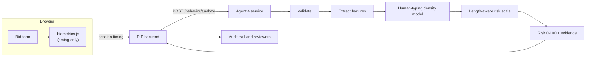

# Agent 4 — Behavioral Biometrics

**Timing-only keystroke analysis that tells scripted or automated bid submission apart from genuine human typing, for the Procurement Integrity Platform (PIP).**

Version 2.0.0 · model `<!--m:model_version str-->2.0.0+4f20da5f<!--/m-->`

Agent 4 watches *how* a bid form is typed, never *what* is typed. It turns the timing of keystrokes into a **risk signal from 0 to 100** with plain-language evidence, for the platform's audit trail and human reviewers. It never blocks a bid and never claims fraud.

> **Important.** The shipped model is trained and evaluated on **synthetic** typing data (the reasons are in `docs/model_card.md`). The results below show that the pipeline works as designed and how it behaves in the simulated world; they are not a promise about real bidders. Before production, retrain on real genuine-human sessions with one command (`python -m agent4 retrain`, see `docs/deployment_guide.md`).

---

## 1. How it works



1. **Collect** (browser): `frontend/biometrics.js` records, for each keystroke, how long the key was held and the gap since the previous key. It never reads which key was pressed.
2. **Describe**: 30 timing statistics per session (spread, shape of the distribution, pauses, speed). None depends on how many keystrokes the session has.
3. **Compare with genuine humans**: a Gaussian-mixture density model, fitted *only on genuine-human sessions*, scores how atypical the session is. It never sees a bot during training.
4. **Calibrate for length**: a short session is naturally noisier than a long one, so the threshold depends on session length. **Risk 50 = more atypical than 95% of genuine humans of similar length; risk 75 = more than 99%.**
5. **Explain**: the response lists which timing properties stand out (for example "unusually regular flight timing") and how reliable the score is for that session length.

Two models are shipped. The **full** model uses hold and flight times (use this). The **flight-only** fallback works when a client can send only inter-key intervals; it is weaker (see results).

## 2. Results at a glance

All numbers come from `reports/metrics.json` on **held-out** sessions (<!--m:dataset.total_sessions int-->39,000<!--/m--> synthetic sessions, seed <!--m:dataset.seed int-->42<!--/m-->). Humans are measured on a test split that was never used to fit or calibrate; automation was never seen in training. Full detail, confidence intervals and charts: `reports/evaluation_report.md`.

| Full model (hold + flight) | Result |
|---|---|
| Genuine humans wrongly flagged (risk ≥ 50) | <!--m:full.human_test.overall.rate pct1-->4.6%<!--/m--> (95% CI <!--m:full.human_test.overall.ci95.0 pct1-->3.8%<!--/m-->–<!--m:full.human_test.overall.ci95.1 pct1-->5.4%<!--/m-->); target 5% |
| Regular script detected | <!--m:full.attacks.REGULAR_AUTOMATION.overall.rate pct0-->100%<!--/m--> |
| Burst injection detected | <!--m:full.attacks.BURST_AUTOMATION.overall.rate pct0-->100%<!--/m--> |
| Adaptive bot (imitates the human range) detected | <!--m:full.attacks.ADAPTIVE_AUTOMATION.overall.rate pct0-->55%<!--/m--> overall: <!--m:full.attacks.ADAPTIVE_AUTOMATION.by_length.10-19.rate pct0-->13%<!--/m--> at 10–19 keystrokes rising to <!--m:full.attacks.ADAPTIVE_AUTOMATION.by_length.200-300.rate pct0-->98%<!--/m--> at 200+ |
| Mimic bot (hard stress test) detected | <!--m:full.attacks.MIMIC_BOT.overall.rate pct0-->45%<!--/m--> |
| ROC-AUC, humans vs. the three core attacks | <!--m:full.summary.roc_auc_core_attacks_vs_human f3-->0.958<!--/m--> |

| Flight-only fallback | Result |
|---|---|
| Genuine humans wrongly flagged | <!--m:flight_only.human_test.overall.rate pct1-->4.6%<!--/m--> |
| Regular script / burst injection | <!--m:flight_only.attacks.REGULAR_AUTOMATION.overall.rate pct0-->100%<!--/m--> / <!--m:flight_only.attacks.BURST_AUTOMATION.overall.rate pct0-->100%<!--/m--> |
| Adaptive bot | <!--m:flight_only.attacks.ADAPTIVE_AUTOMATION.overall.rate pct0-->2%<!--/m--> (not separable without hold times) |

**What these numbers do and do not mean**

* Detection of subtle bots grows with the amount of typing observed; the response carries a `reliability` field (`low` < 30 keystrokes, `medium` 30–99, `high` ≥ 100).
* When bots are rare, most flags are still false alarms, however good the detector. Use HIGH (risk ≥ 75) for priority review and combine the signal with other evidence. Precision at realistic base rates is in the evaluation report.
* **A typing style the model never saw is flagged.** When a genuine style was withheld from training, <!--m:leave_one_style_out.HUMAN_LIKE.held_out_style_flagged.rate pct0-->51%<!--/m-->–<!--m:leave_one_style_out.SLOW_HUMAN_LIKE.held_out_style_flagged.rate pct0-->81%<!--/m--> of its sessions were flagged. The model defines "normal" as the population it was trained on, so it must be retrained on the platform's real users before deployment.

## 3. Quick start

Requires Python 3.10+. From this folder:

```bash
pip install -r requirements-dev.txt        # training + tests (serving alone needs only requirements.txt)

python -m pytest                           # run the test-suite
python -m agent4 all                       # regenerate data, selection, model, evaluation, figures, reports
python -m agent4 serve                     # start the API on http://127.0.0.1:8000  (docs at /docs)
python -m agent4 score docs/examples/automation_full.request.json    # score one payload from the CLI
```

Call the API:

```bash
curl -s http://127.0.0.1:8000/behavior/analyze -H "Content-Type: application/json" \
     -d @docs/examples/automation_full.request.json
```

Request (timing only) and a typical answer:

```json
{ "session_id": "opaque-token-123",
  "intervals":      [412.3, 118.0, 95.4, 143.7, "..."],
  "hold_durations": [ 84.1,  76.9, 91.3,  80.2, "..."] }
```

```json
{ "status": "scored", "scoring_mode": "full",
  "behavioral_risk_score": 100.0, "risk_category": "HIGH_ANOMALY", "behavioral_anomaly": true,
  "reliability": "medium",
  "behavioral_evidence": ["unusually_regular_hold_timing", "unusually_regular_flight_timing"],
  "events_received": 40, "events_scored": 40, "model_version": "…" }
```

Complete, generated examples (which a test compares with the live API) are in `docs/examples/`. The field-by-field contract is in `docs/integration_guide.md`.

## 3b. Demo website and automated bot tests

A runnable stand-in for the rest of the platform: a bid portal with the browser collector, a live dashboard, and a bot lab that drives **real automated browsers** (Playwright + Edge) against the shipped model.

```bash
pip install -r requirements-demo.txt
python -m demo serve        # portal http://127.0.0.1:8100/  and live dashboard http://127.0.0.1:8100/dashboard
python -m demo test         # clean server, every bot and human scenario, writes reports/demo/
```

Type a bid yourself, start bots from the dashboard, and compare. The automated test judges each scenario against expectations written before the first run, with confidence intervals, and says INCONCLUSIVE rather than PASS when there are too few visits. Results: `reports/demo/demo_test_report.md`. How it works and what it does not show: `docs/demo_guide.md`.

## 4. What is in this folder

| Path | What it is |
|---|---|
| `agent4/` | The Python package: simulator, features, detector, calibration, scorer, API service, evaluation, CLI |
| `models/` | The trained model: one JSON bundle per mode plus `manifest.json` with SHA-256 hashes (no pickle) |
| `frontend/` | The browser collector `biometrics.js`, a demo page, and its in-browser self-test |
| `demo/` | The demo website (bid portal, live dashboard, bot lab) and the automated browser bot tests; not part of the deployable service |
| `reports/` | `evaluation_report.md`, `metrics.json`, figures, model-selection results, latency benchmark, OpenAPI spec |
| `docs/` | Model card, integration guide, deployment guide, privacy and security, architecture, limitations, changes from v1 |
| `tests/` | 100+ automated tests (unit, API contract, artifact integrity, leakage guards, browser round-trip, docs-as-tests) |
| `scripts/` | Example generator and a live-server smoke test |
| `data/` | Generated synthetic sessions (reproducible from the seed; safe to delete and regenerate) |
| `Dockerfile`, `docker-compose.yml`, `.env.example` | Deployment files (see the note on Docker in `docs/deployment_guide.md`) |

## 5. Privacy and security in one paragraph

Only timing numbers leave the browser. The collector never reads `event.key`/`event.code` by default; the API rejects any field other than `session_id`, `intervals` and `hold_durations`; `session_id` is restricted to opaque-token characters, so a name or e-mail address cannot be sent; request bodies are never logged; error responses never echo submitted values; the model artifact is JSON verified against a SHA-256 manifest at start-up; API keys, request-size limits and a non-root container are supported. Details and the threat model are in `docs/privacy_and_security.md`.

## 6. Known limits

Synthetic training data · needs retraining on real bidders · weaker on short sessions and on bots that mimic human statistics · cannot detect a replay of recorded human timing · timing varies with hardware, browser and field type, none of which is modelled. The honest list, with the roadmap, is in `docs/limitations_and_roadmap.md`.

## 7. Differences from the first version

Version 1 flagged most genuine short sessions and every fast typist, and some of its documented examples did not match its real output. Version 2 is a rebuild: features that do not depend on session length, length-aware thresholds, a model trained on the full human population, held-out evaluation with confidence intervals, a verified artifact format, a hardened API, a tested browser collector and documentation that is checked against the code. See `docs/CHANGES_FROM_V1.md` for the full account with evidence.
