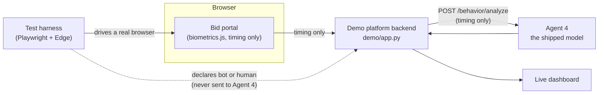

# Demo website and automated bot tests

A runnable stand-in for the rest of the platform, so the trained model can be **seen working end to end** and **tested against real automated browsers**. It is a test bench, not part of the deployable service: the Docker image and the Python package contain only `agent4/` and `models/`.



## 1. Start it

```bash
pip install -r requirements-demo.txt       # adds Playwright; it drives the Edge or Chrome already on your machine
python -m demo serve                       # portal, dashboard and bot lab on http://127.0.0.1:8100
```

| Page | What it is |
|---|---|
| `http://127.0.0.1:8100/` | The **bid portal**. Type a bid as a normal user and watch the signal update. |
| `http://127.0.0.1:8100/dashboard` | The **live dashboard**: every bid as it arrives, bot lab, and the bot-versus-human results. |
| `http://127.0.0.1:8100/agent4/docs` | The real Agent 4 API documentation (the same app a deployment runs). |

Agent 4 runs inside the demo process by default. To use a separately running (or deployed) Agent 4 instead: `python -m demo serve --agent4-url http://host:8000` (add `--agent4-api-key` if it requires one).

## 2. What you can do

1. **Visit as a normal human.** Open the portal and fill in the form by hand. After 10 keystrokes the panel on the right shows the risk score, category, reliability, the plain-language evidence, and the exact timing numbers that were sent. Submit the bid: it is always accepted; the signal is attached for reviewers.
2. **Trigger automated interactions.**
   * *In the page:* the three **Script** buttons press keys with JavaScript inside the portal (instant, steady rhythm, random delays).
   * *Real automated browsers:* the **bot lab** on the dashboard starts Playwright driving Microsoft Edge. Each scenario opens the portal in a fresh browser, types, and submits. Tick *Show the browser window* to watch it type.
3. **Observe the model's predictions** in the portal panel and in the dashboard's *Latest bids* table.
4. **View the live dashboard.** Counters, a risk-score timeline (blue circle = labelled human, orange diamond = bot, green square = a visitor who typed by hand, cross = no verdict), per-scenario results and the latest bids. It refreshes every second and supports light and dark mode.
5. **Run controlled automated tests.** From the dashboard (*Run every scenario*) or from the command line:

```bash
python -m demo test            # clean server, every scenario, writes reports/demo/
python -m demo test --quick    # a six-visit smoke run (most verdicts will say INCONCLUSIVE: too few visits)
python -m demo bots --scenarios pw_instant,pw_jitter --runs 10   # against a server you already started
```

`python -m demo test` takes about 45 minutes with the default 40 visits per scenario (60 for the simulated humans) on three parallel browsers, because the human-timing scenarios replay real seconds of typing. It starts its own clean server, so it never mixes with your manual sessions.

## 3. The scenarios

| Scenario | Is really | Driven by | What it does | Expectation (written before any run) |
|---|---|---|---|---|
| Instant typing | bot | Playwright | `keyboard.type(text)` with no delay | must be detected |
| Fixed-delay typing | bot | Playwright | `keyboard.type(text, delay=120)` | must be detected |
| Metronome script | bot | Playwright | key down, 60 ms, key up, 110 ms, repeat | must be detected |
| Burst injection | bot | Playwright | 5-14 characters instantly, then a 0.4-0.85 s gap | must be detected |
| Random-delay bot | bot | Playwright | independent random hold and gap inside the human range | informational (no target) |
| Human-statistics mimic | bot | Playwright | copies a human's mean and spread with bell-shaped noise | informational (no target) |
| Programmatic fill | bot | Playwright | `page.fill()`: no key events at all | no verdict expected |
| Replay of a recorded person | bot | Playwright | replays the exact timing of a real visitor | known limitation |
| Simulated typical / fast / slow human | human | training generator, replayed in Edge | timing from the same generator that made the training data | false-alarm rate consistent with the 5% design target |

Every scenario runs at three session lengths (about 12-29, 30-99 and 100-220 keystrokes), because detection depends on length.

The *replay* scenario needs timing from a real person, so it appears only after someone has submitted a bid by hand on the portal. Those sessions (timing numbers only) are kept in the `demo/runtime/` folder; delete it to forget them.

## 4. How verdicts are decided

The decision rules were fixed before the first run, and each uses the 95% Wilson confidence interval so that a verdict needs enough data:

| Expectation | PASS | FAIL | otherwise |
|---|---|---|---|
| must be detected | interval's lower bound is at least 90% | upper bound is below 90% | INCONCLUSIVE |
| humans must pass | interval's upper bound is at most 15% | lower bound is above 10% | INCONCLUSIVE |
| no verdict expected | no bid was scored | some bid was scored | n/a |
| informational, known limitation | no target: the rate is reported | no target | INFO |

So 5 visits that were all detected are **INCONCLUSIVE**, not PASS: five visits cannot show a 90% detection rate. It takes at least 35 perfect visits to pass.

## 5. Reading the report

`python -m demo test` writes, in `reports/demo/`:

* `demo_test_report.md`: results per scenario with confidence intervals, detection by session length, harness checks and the honest limits of the test;
* `demo_test_results.json`: all the numbers, including every visit;
* `risk_by_scenario.png`: the risk score of every bid, by scenario;
* `dashboard.png` and `portal.png`: screenshots of the two pages after the run.

The *harness checks* answer "did the test itself work?": the number of keystrokes the browser captured equals the number typed, and the timing the browser measured matches the timing the harness asked for. If those fail, the detection numbers cannot be trusted.

The *synthetic benchmark* column puts the matching held-out rate from `reports/metrics.json` next to each browser result. The two come from different samples and are not expected to be identical.

## 6. What the test does and does not show

* **The bots are real, but narrow.** Playwright sending Chrome DevTools key events into Edge. Selenium, AutoHotkey, hardware keyboard emulators, remote-desktop tools and other browsers were not tested.
* **The simulated humans are not real people.** They come from the generator that produced the training data. Their false-alarm rate shows the browser pipeline reproduces timing faithfully, not that real people pass. The only real humans are visitors who type on the portal by hand; they appear separately as *Visitor*.
* **Programmatic fill is invisible to Agent 4 by design.** With no keystrokes there is nothing to score. The platform must treat "bid submitted with no behavioural data" as a signal of its own; the demo backend records it as *No data*. This is the single most important integration rule for the real platform.
* **A replay of real human timing passes.** Timing alone cannot tell a replay from the person.
* **Small samples.** With a few dozen visits per scenario the intervals are wide.

## 7. How the demo maps onto the real platform

| Demo piece | In the real platform |
|---|---|
| `frontend/biometrics.js` in the portal | The same collector, on the real bid form. |
| `POST /demo/api/behavior` | **Your platform backend** calls Agent 4's `POST /behavior/analyze` (never the browser directly in production). |
| `POST /demo/api/bids` | The bid submission. It joins the bid with the signal recorded for the same session id, and records *no data* if none arrived. |
| Platform note | What reviewers see: a high score queues for human review; nothing blocks a bid. |
| `POST /demo/api/truth` | **Test only.** A production system never has ground truth. |

The full contract is in [integration_guide.md](integration_guide.md).

## 8. Safety of the demo itself

* The bot lab starts browsers, so it exists only when the server is bound to a loopback address (the default). `--host 0.0.0.0` switches it off. It accepts only registered scenario names, caps the visits per scenario, runs one job at a time, and a cancelled job kills its browsers.
* The pages are served with a strict content security policy (same-origin scripts and styles only, no inline code) and contain no third-party resources. The tests check this.
* Typed text never leaves the browser: the portal sends only timing numbers, and the stored sessions contain only timing numbers.
* The ground-truth label is kept on the platform side and is never forwarded to Agent 4; a test checks exactly which fields are forwarded.
* Do not expose the demo server to a network. It has no authentication and its dashboard can reset its data.

## 9. Troubleshooting

| Problem | What to do |
|---|---|
| `playwright` is not installed | `pip install -r requirements-demo.txt` |
| "Neither Microsoft Edge nor Google Chrome could be launched" | Install Edge or Chrome; Playwright uses the installed browser, so no download is needed. |
| Port 8100 is busy | `python -m demo serve --port 8200` |
| The bot lab says it is switched off | Start the server on `127.0.0.1` without `--no-bot-lab`. |
| Many scenarios say INCONCLUSIVE | Too few visits. Use more *runs per scenario* (about 40 for the detection scenarios, 60 for the humans). |
| Timing error is large in the harness checks | Something else was using the CPU. Close other programs, or use fewer `--workers`. |

Settings for the demo server (command-line options): `--host`, `--port`, `--no-bot-lab`, `--agent4-url`, `--agent4-api-key` (or the environment variable `DEMO_AGENT4_API_KEY`), `--model-dir`, `--persist`, `--no-persist`. Agent 4 itself still reads its usual `AGENT4_*` settings, described in [deployment_guide.md](deployment_guide.md).
