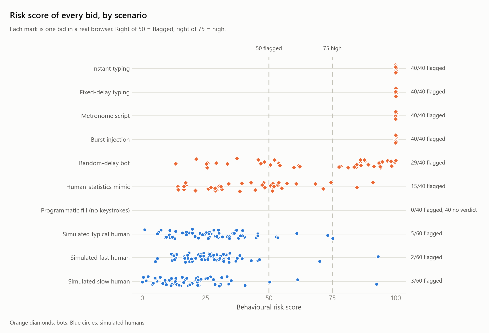

# Browser bot test: Agent 4 behind a demo platform

Generated 2026-10-14 14:47 UTC by `python -m demo test`. Model `2.0.0+4f20da5f`, Agent 4 running in-process.

Real automated browsers (Playwright driving Microsoft Edge) visited a demo bid portal, typed into the form and submitted. The portal's collector sent keystroke timing to a stand-in platform backend, which forwarded it to the shipped Agent 4 model. The table is built from what the platform recorded. The test harness told the platform what each visit really was (bot or human) before it typed; Agent 4 was never told.

## Result

**7 expectations passed, 0 failed, 1 inconclusive** (too few visits to tell). 2 informational (no target set), 1 not run. Expectations and decision rules were written before the first run and were not changed afterwards.

| Group | Bids | Flagged (risk >= 50) | Flagged or no data | High (risk >= 75) |
|---|---:|---:|---:|---:|
| Bots (all scenarios) | 280 | 204 (73%, CI 67%-78%) | 87% | 184 |
| Simulated humans | 180 | 10 (6%, CI 3%-10%) | 6% | 3 |

## Per scenario

| Scenario | Is really | Bids | Flagged | Median risk | No verdict | Synthetic benchmark | Result |
|---|---|---:|---:|---:|---:|---:|---|
| Instant typing | bot | 40 | 40/40 (100%, CI 91%-100%) | 100.0 | 0 | - | **PASS** |
| Fixed-delay typing | bot | 40 | 40/40 (100%, CI 91%-100%) | 100.0 | 0 | - | **PASS** |
| Metronome script | bot | 40 | 40/40 (100%, CI 91%-100%) | 100.0 | 0 | 100% | **PASS** |
| Burst injection | bot | 40 | 40/40 (100%, CI 91%-100%) | 100.0 | 0 | 100% | **PASS** |
| Random-delay bot | bot | 40 | 29/40 (72%, CI 57%-84%) | 79.8 | 0 | 55% | **INFO** |
| Human-statistics mimic | bot | 40 | 15/40 (38%, CI 24%-53%) | 41.1 | 0 | 45% | **INFO** |
| Programmatic fill (no keystrokes) | bot | 40 | 0/40 (0%, CI 0%-9%) | - | 40 | - | **PASS** |
| Replay of a recorded person | bot | 0 | - | - | - | - | NOT RUN |
| Simulated typical human | human | 60 | 5/60 (8%, CI 4%-18%) | 26.8 | 0 | 5% | **INCONCLUSIVE** |
| Simulated fast human | human | 60 | 2/60 (3%, CI 1%-11%) | 26.5 | 0 | 6% | **PASS** |
| Simulated slow human | human | 60 | 3/60 (5%, CI 2%-14%) | 16.6 | 0 | 3% | **PASS** |

The *synthetic benchmark* column is the matching held-out rate from `reports/metrics.json` (a different, much larger sample of simulated sessions) for the scenarios that have an equivalent simulated class.

### What each scenario expected

* **Instant typing** (bot; Playwright (real Edge, CDP key events)). Keys arrive about a millisecond apart and are held for under a millisecond. PASS needs the 95% lower bound of the flagged rate to reach 90%.  
  Outcome: 40/40 flagged (100%, 95% CI 91-100%)
* **Fixed-delay typing** (bot; Playwright (real Edge, CDP key events)). Every key is held exactly as long as the delay and keys follow one another instantly. PASS needs the 95% lower bound of the flagged rate to reach 90%.  
  Outcome: 40/40 flagged (100%, 95% CI 91-100%)
* **Metronome script** (bot; Playwright (real Edge, CDP key events)). Identical hold and gap on every key. PASS needs the 95% lower bound of the flagged rate to reach 90%.  
  Outcome: 40/40 flagged (100%, 95% CI 91-100%)
* **Burst injection** (bot; Playwright (real Edge, CDP key events)). Rapid clusters separated by fixed gaps. PASS needs the 95% lower bound of the flagged rate to reach 90%.  
  Outcome: 40/40 flagged (100%, 95% CI 91-100%)
* **Random-delay bot** (bot; Playwright (real Edge, CDP key events)). The standard evasion. No target is set: detection is expected to grow with session length (the synthetic benchmark shows 13% at 10-19 keys up to 98% at 200+).  
  Outcome: 29/40 flagged (72%, 95% CI 57-84%)
* **Human-statistics mimic** (bot; Playwright (real Edge, CDP key events)). The hard case. Partial detection is the documented outcome (the synthetic benchmark shows 45%).  
  Outcome: 15/40 flagged (38%, 95% CI 24-53%)
* **Programmatic fill (no keystrokes)** (bot; Playwright (real Edge, CDP key events)). With no keystrokes there is nothing to score. Agent 4 correctly returns no verdict, so the platform has to treat 'bid submitted with no behavioural data' as a signal of its own.  
  Outcome: 40/40 bids had no behavioural data and Agent 4 gave no verdict
* **Replay of a recorded person** (bot; Playwright replaying real human timing). A replay of genuine human timing is genuine human timing. A timing-only detector cannot catch it (documented limitation); most should pass as human.  
  Outcome: No sessions recorded for this scenario yet.
* **Simulated typical human** (human; Simulated human (training-data generator) replayed in Edge). False-alarm rate consistent with the 5% design target: PASS needs the 95% upper bound of the flagged rate to be at most 15%; FAIL if its lower bound is above 10%.  
  Outcome: 5/60 flagged (8%, 95% CI 4-18%); not enough visits to show 15% or less
* **Simulated fast human** (human; Simulated human (training-data generator) replayed in Edge). False-alarm rate consistent with the 5% design target: PASS needs the 95% upper bound of the flagged rate to be at most 15%; FAIL if its lower bound is above 10%.  
  Outcome: 2/60 flagged (3%, 95% CI 1-11%)
* **Simulated slow human** (human; Simulated human (training-data generator) replayed in Edge). False-alarm rate consistent with the 5% design target: PASS needs the 95% upper bound of the flagged rate to be at most 15%; FAIL if its lower bound is above 10%.  
  Outcome: 3/60 flagged (5%, 95% CI 2-14%)

## Detection by session length

Share of scored bids flagged, by number of keystrokes.

| Scenario | 10-29 keys | 30-99 keys | 100+ keys |
|---|---|---|---|
| Instant typing | 100% (n=14) | 100% (n=13) | 100% (n=13) |
| Fixed-delay typing | 100% (n=14) | 100% (n=13) | 100% (n=13) |
| Metronome script | 100% (n=14) | 100% (n=13) | 100% (n=13) |
| Burst injection | 100% (n=14) | 100% (n=13) | 100% (n=13) |
| Random-delay bot | 29% (n=14) | 92% (n=13) | 100% (n=13) |
| Human-statistics mimic | 14% (n=14) | 23% (n=13) | 77% (n=13) |
| Simulated typical human | 10% (n=20) | 5% (n=20) | 10% (n=20) |
| Simulated fast human | 5% (n=20) | 5% (n=20) | 0% (n=20) |
| Simulated slow human | 5% (n=20) | 0% (n=20) | 10% (n=20) |

## Did the test itself work?

| Scenario | Visits | Failed | Events captured = events typed | Median hold error (ms) | Median gap error (ms) | Worst 95th-pct gap error (ms) |
|---|---:|---:|---:|---:|---:|---:|
| pw_burst | 40 | 0 | 40/40 | - | - | - |
| pw_fill | 40 | 0 | 40/40 | - | - | - |
| pw_fixed_delay | 40 | 0 | 40/40 | - | - | - |
| pw_instant | 40 | 0 | 40/40 | - | - | - |
| pw_jitter | 40 | 0 | 40/40 | 0.2 | 0.2 | 1.7 |
| pw_metronome | 40 | 0 | 40/40 | 0.2 | 0.2 | 1.0 |
| pw_mimic | 40 | 0 | 40/40 | 0.2 | 0.2 | 1.3 |
| sim_fast | 60 | 0 | 60/60 | 0.2 | 0.2 | 1.0 |
| sim_slow | 60 | 0 | 60/60 | 0.2 | 0.2 | 1.2 |
| sim_typical | 60 | 0 | 60/60 | 0.2 | 0.2 | 1.4 |

Timing error is the difference between the hold or gap the harness asked for and what the browser measured, for the scenarios that replay a timing plan. It shows how faithfully the browser pipeline reproduces the intended rhythm. 460 of 460 planned visits completed.

## Figure

## What this does and does not show

* **Bots are real automation, but narrow.** Playwright sending Chrome DevTools key events into Edge. Selenium, AutoHotkey, hardware keyboard emulators, remote-desktop tools and other browsers were not tested.
* **The human side is simulated.** The simulated humans come from the same generator that produced the training data, so a low false-alarm rate here shows the browser pipeline reproduces timing faithfully, not that real people pass. The only real humans are visitors who type on the portal by hand (shown separately).
* **A replay of a real person's timing is a documented blind spot.** Timing alone cannot separate a replay from the person.
* **Bids with no keystrokes get no score by design.** The platform must treat 'no behavioural data' as a signal of its own; the demo backend does, Agent 4 does not.
* **Small samples.** Intervals are 95% Wilson intervals; with a few dozen visits per scenario they are wide.

Environment: Windows 10, Python 3.10.11, Playwright 1.64.0, browser 155.0.4283.45; seed 2026, 40 visits per scenario, 3 workers, 2576 s.
