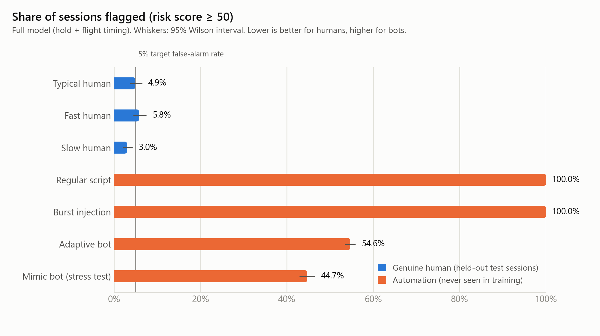
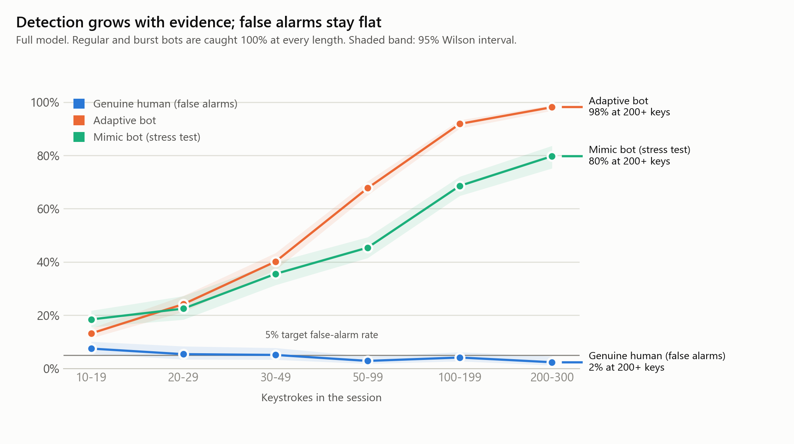
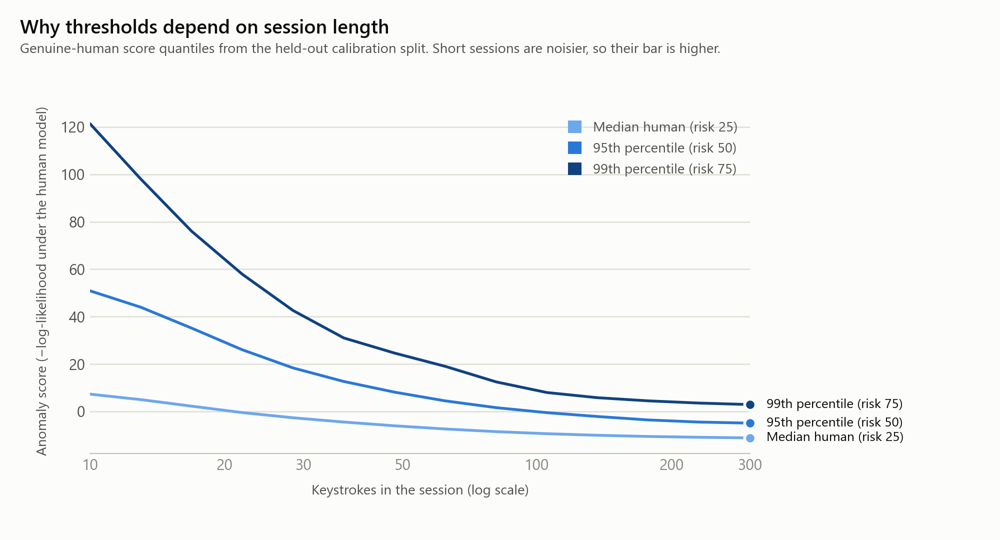
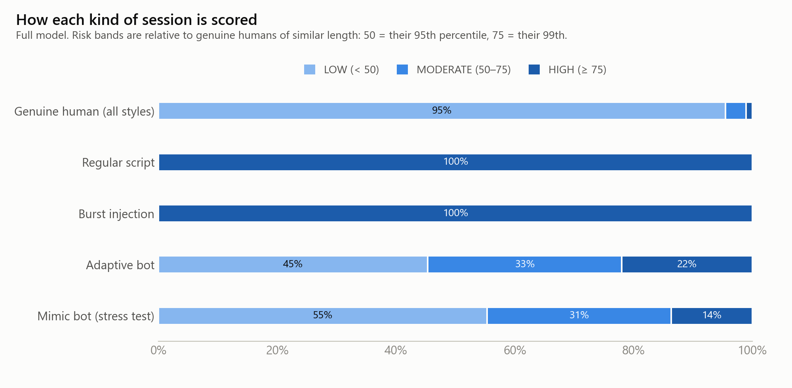
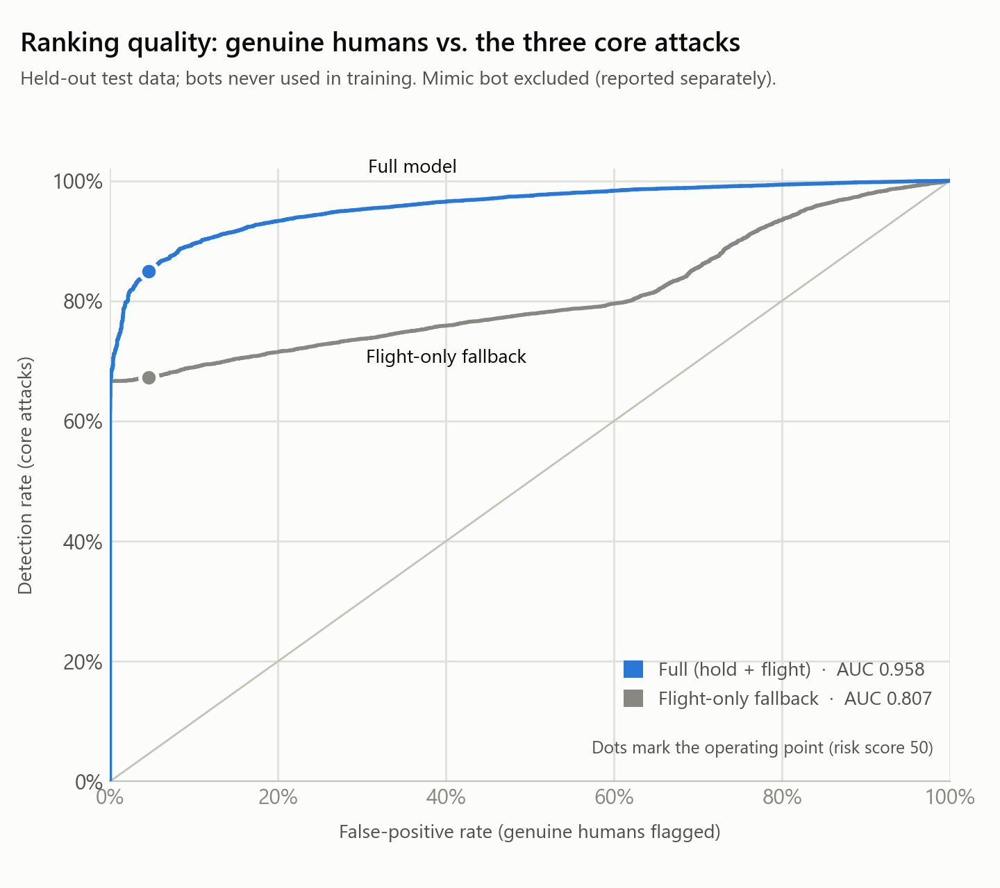
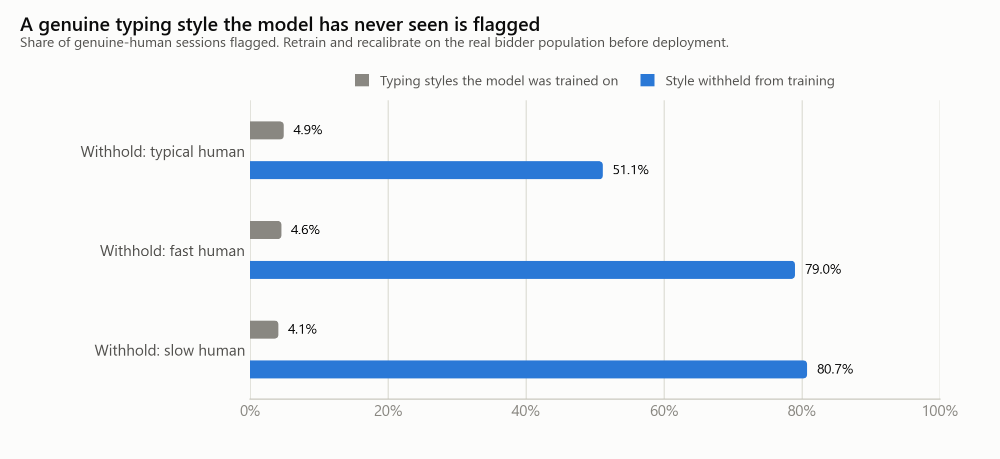

# Agent 4 — Evaluation report

Model version `2.0.0+4f20da5f` · generated by `python -m agent4 all` · every number below is read from `reports/metrics.json`.

> **Read this first.** All data are *synthetic* timing sessions produced by `agent4/simulation.py`. These results show the pipeline is correct and how the detector behaves on the simulated world; they do not prove performance against real bidders or real bots. See *Limitations* and the model card.

## 1. Protocol

* 39,000 sessions, seed 42, 10–300 keystrokes each (log-uniform lengths, so short and long sessions are both common).
* **Genuine humans** (typical, fast, slow typists) are split 60% train / 25% calibration / 15% test, by session. The detector is fitted on *train* only; the threshold and risk scale come from the disjoint *calibration* split; every human rate below is measured on *test*, so it is a genuine out-of-sample estimate (not true by construction).
* **Automation** classes never appear in training or calibration; they are used only to measure detection.
* The detector family and size were chosen on a *separate development dataset* (different seed), never on these test sessions. See section 6.
* A session is **flagged** when its risk score is ≥ 50 (more atypical than 95% of genuine humans of similar length). Intervals are 95% Wilson confidence intervals.

## 2. Headline results (full model: hold + flight timing)

| Measure | Value |
|---|---|
| Genuine-human false-alarm rate (test, risk ≥ 50) | 4.6% (3.8%–5.4%) |
| Genuine humans in the HIGH band (risk ≥ 75) | 1.0% (0.7%–1.5%) |
| Macro detection rate, three core attacks | 84.9% |
| ROC-AUC, core attacks vs. humans | 0.958 (95% CI 0.955–0.960) |

| Class | Role | Sessions | Flagged (risk ≥ 50), 95% CI | ROC-AUC vs. humans |
|---|---|---|---|---|
| Typical human | genuine human | 900 | 4.9% (3.7%–6.5%) | — |
| Fast human | genuine human | 900 | 5.8% (4.4%–7.5%) | — |
| Slow human | genuine human | 900 | 3.0% (2.1%–4.3%) | — |
| Regular script | automation | 6000 | 100.0% (99.9%–100.0%) | 1.000 |
| Burst injection | automation | 6000 | 100.0% (99.9%–100.0%) | 1.000 |
| Adaptive bot | automation | 6000 | 54.6% (53.4%–55.9%) | 0.873 |
| Mimic bot (stress test) | automation (stress test) | 3000 | 44.7% (42.9%–46.5%) | 0.826 |

## 3. Reliability grows with session length

Percentages are the share of sessions flagged at each length. A short session carries little timing evidence, so the adaptive and mimic bots are hard to separate from humans until a few dozen keystrokes have been seen. The API reports this as `reliability` (`low` < 30, `medium` 30–99, `high` ≥ 100 keystrokes).

| Keystrokes | 10-19 | 20-29 | 30-49 | 50-99 | 100-199 | 200-300 |
|---|---|---|---|---|---|---|
| Genuine human (false alarms) | 7.5% | 5.4% | 5.1% | 2.9% | 4.1% | 2.4% |
| Regular script | 100% | 100% | 100% | 100% | 100% | 100% |
| Burst injection | 100% | 100% | 100% | 100% | 100% | 100% |
| Adaptive bot | 13% | 24% | 40% | 68% | 92% | 98% |
| Mimic bot (stress test) | 18% | 22% | 36% | 45% | 69% | 80% |

## 4. What a flag is worth in practice

When bots are rare, most flags are false alarms, however good the detector. Precision at three assumed base rates (share of sessions that are automated), using the measured rates above:

| Assumed share of sessions that are automated | Precision of MODERATE+HIGH (risk ≥ 50) | Precision of HIGH only (risk ≥ 75) |
|---|---|---|
| 0.1% | 1.8% | 6.7% |
| 1.0% | 15.8% | 41.9% |
| 5.0% | 49.5% | 79.0% |

This is why the service emits a *signal for human review* and never blocks a bid: use HIGH for priority review and combine with other evidence before acting.

## 5. Flight-only fallback

Used when a client can send only inter-key intervals (no hold times). With no hold-time information the adaptive bot is not distinguishable from humans, which is an inherent limit of that mode, not a tuning problem.

| Measure | Value |
|---|---|
| Genuine-human false-alarm rate (test) | 4.6% (3.9%–5.5%) |
| Macro detection rate, three core attacks | 67.3% |
| ROC-AUC, core attacks vs. humans | 0.807 |

| Class | Role | Sessions | Flagged (risk ≥ 50), 95% CI | ROC-AUC vs. humans |
|---|---|---|---|---|
| Typical human | genuine human | 900 | 4.0% (2.9%–5.5%) | — |
| Fast human | genuine human | 900 | 6.2% (4.8%–8.0%) | — |
| Slow human | genuine human | 900 | 3.7% (2.6%–5.1%) | — |
| Regular script | automation | 6000 | 100.0% (99.9%–100.0%) | 1.000 |
| Burst injection | automation | 6000 | 100.0% (99.9%–100.0%) | 1.000 |
| Adaptive bot | automation | 6000 | 1.9% (1.6%–2.3%) | 0.422 |
| Mimic bot (stress test) | automation (stress test) | 3000 | 47.7% (45.9%–49.5%) | 0.749 |

## 6. Detector selection (development data, seed 7)

Criterion: simplest detector whose macro-average detection rate over REGULAR/BURST/ADAPTIVE is within 1% of the best, at ~5% human false-alarm rate (candidates with human FPR above 7.5% are ineligible).

**full** — selected `gaussian_mixture_k2`

| Detector | Human FPR | Regular | Burst | Adaptive | Macro (core) | Mimic (info only) |
|---|---|---|---|---|---|---|
| mahalanobis | 4.3% | 100% | 100% | 44% | 81.2% | 26% |
| gaussian_mixture_k1 | 4.2% | 100% | 100% | 42% | 80.7% | 26% |
| gaussian_mixture_k2 | 4.0% | 100% | 100% | 56% | 85.4% | 52% |
| gaussian_mixture_k3 | 4.0% | 100% | 100% | 54% | 84.6% | 51% |
| gaussian_mixture_k4 | 4.8% | 100% | 100% | 54% | 84.7% | 54% |
| gaussian_mixture_k6 | 3.9% | 100% | 100% | 55% | 84.9% | 57% |
| gaussian_mixture_k8 | 4.4% | 100% | 100% | 39% | 79.6% | 60% |
| isolation_forest | 5.0% | 100% | 100% | 5% | 68.4% | 3% |
| isolation_forest_whitened | 3.9% | 100% | 100% | 39% | 79.8% | 24% |

**flight_only** — selected `gaussian_mixture_k4`

| Detector | Human FPR | Regular | Burst | Adaptive | Macro (core) | Mimic (info only) |
|---|---|---|---|---|---|---|
| mahalanobis | 5.1% | 100% | 100% | 1% | 66.9% | 18% |
| gaussian_mixture_k1 | 5.1% | 100% | 100% | 1% | 66.9% | 18% |
| gaussian_mixture_k2 | 5.1% | 100% | 100% | 1% | 66.9% | 44% |
| gaussian_mixture_k3 | 5.0% | 100% | 100% | 1% | 66.9% | 46% |
| gaussian_mixture_k4 | 5.6% | 100% | 100% | 2% | 67.4% | 51% |
| gaussian_mixture_k6 | 5.6% | 100% | 100% | 4% | 67.8% | 55% |
| gaussian_mixture_k8 | 5.5% | 100% | 100% | 4% | 68.1% | 54% |
| isolation_forest | 5.5% | 73% | 100% | 0% | 57.7% | 1% |
| isolation_forest_whitened | 5.0% | 100% | 100% | 1% | 66.9% | 19% |

Isolation Forest was the v1 detector. It needs the anomaly to be extreme along many features at once, so it misses bots that differ from humans only in the *shape* of their timing distribution. A mixture density over log-transformed features uses that evidence directly, and exports to plain NumPy arrays (no pickle, no scikit-learn at serving time).

## 7. A typing style the model has never seen

Each human style was withheld in turn: the model was refitted and recalibrated on the other two styles, then asked to score the withheld style.

| Withheld style | Trained-on styles flagged (test) | Withheld style flagged |
|---|---|---|
| Typical human | 4.9% (4.0%–6.0%) | 51.1% (49.9%–52.4%) |
| Fast human | 4.6% (3.7%–5.6%) | 79.0% (77.9%–80.0%) |
| Slow human | 4.1% (3.3%–5.1%) | 80.7% (79.7%–81.7%) |

**Consequence:** the model defines *normal* as the typing styles it was trained on. A genuine style outside that population is flagged. Before deployment, retrain and recalibrate on real, representative bidder sessions (`python -m agent4 retrain`), and monitor the live share of flagged sessions: it should sit near 5%.

## 8. Limitations

* Synthetic data from one generator: absolute numbers will change on real data. The *relative* findings (length dependence, shape features, the need for population-representative training) are the transferable part.
* The mimic bot, which copies human mean/spread/pause rate, is only partly detected. A replay of recorded human timing would be harder still; it needs sequence-level or non-timing signals.
* Hardware, keyboard, browser timer resolution and field type (numeric amount vs. free text) change real timing; none is modelled.
* The score is a statistical signal about timing, not evidence of fraud.
