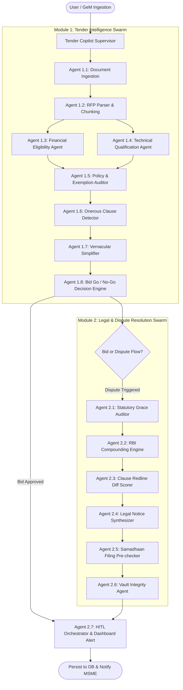
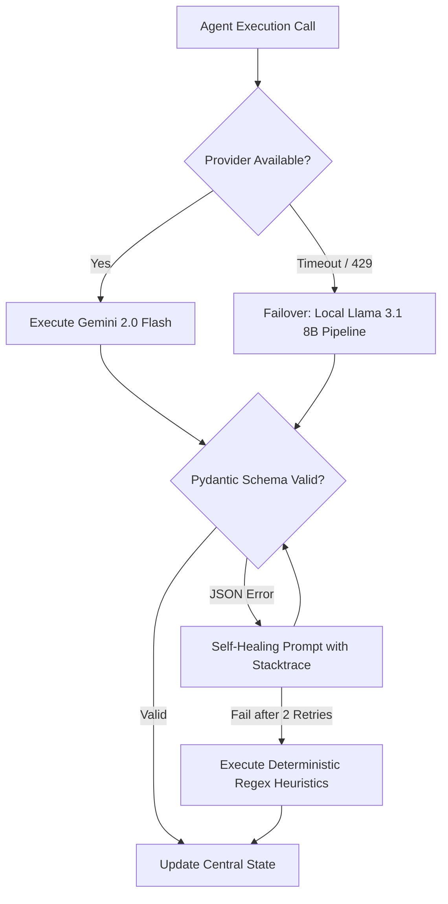

# Agentic AI Components & Multi-Agent Orchestration

**Project Scope:** Module 1 (MSME Copilot & Tender Intelligence), Module 2 (Legal & MSMED Dispute Resolution Engine), and Autonomous Orchestration.
**Author / Contributor Scope:** Solely covering Agentic AI systems, sub-agents, state machines, and tools designed for the User's subsystem.
**Classification:** Advanced Agentic Systems Architecture & Engineering Specifications.

---

## 1. Defining "Agentic AI" in ProcureGuard-AI

While standard Generative AI operates as a passive, stateless question-and-answer tool, **Agentic AI** possesses:

1. **Autonomous Goal Directedness:** Given an objective (e.g., *"Assess this 120-page tender for an MSME auto-parts manufacturer and determine bid viability"*), the agent formulates a multi-step execution plan without continuous user prompting.
2. **State Persistence:** Maintains and mutates a central context object (`ProcurementCopilotState`) across complex multi-step pipelines.
3. **Tool Execution & Grounding:** Proactively queries external tools, database registries, vector indices, and mathematical calculators.
4. **Self-Reflection & Healing:** Audits its own extractions against schemas; if validation fails, it inspects the error trace and retries with refined constraints.
5. **Human-in-the-Loop (HITL) Delegation:** Knows its operational boundaries and safely pauses execution when high-consequence legal or financial actions require human sign-off.

---

## 2. Multi-Agent Orchestration Architecture (LangGraph StateGraph)

The user's subsystem employs a **Hierarchical Directed Acyclic Graph (DAG)** orchestration model implemented via **LangGraph / StateGraph** design patterns:



---

## 3. Central State Schema: `ProcurementCopilotState`

State is strongly typed using Python typing and Pydantic primitives, preventing silent attribute errors across agent handoffs:

```python
class ProcurementCopilotState(TypedDict):
    tender_id: str
    tender_title: str
    raw_pdf_path: Optional[str]
    clean_text_stream: Optional[str]
    chunks: List[str]
  
    # MSME Profile Context
    vendor_id: str
    vendor_udyam_number: str
    vendor_annual_turnover: float
    vendor_experience_years: int
    vendor_certifications: List[str]
  
    # Module 1 Extraction Sub-states
    extracted_criteria: Dict[str, Any]
    exemption_audit_log: List[Dict[str, Any]]
    onerous_clauses: List[Dict[str, Any]]
    plain_language_summary: Dict[str, str]  # English & Vernacular
  
    # Strategic Decision State
    bid_suitability_score: float           # 0 to 100
    go_no_go_recommendation: str           # "GO", "NO_GO", "CONDITIONAL_GO"
  
    # Module 2 Legal & Dispute Sub-states
    dispute_invoice_id: Optional[str]
    unpaid_principal: float
    delayed_days_statutory: int
    rbi_penal_interest_accrued: float
    clause_redline_deviations: List[Dict[str, Any]]
    statutory_legal_notice_markdown: Optional[str]
  
    # System Execution Metadata
    agent_execution_log: List[str]
    confidence_score: float
    requires_human_review: bool
    review_reason: Optional[str]
```

---

## 4. Comprehensive Catalog of the 15 Specialized Sub-Agents

### 4.1. Module 1: Tender Intelligence Swarm

| Sub-Agent ID & Name                              | Autonomous Mission                                                                                                | Tools Utilized                                              | Failure Recovery / Guardrail                                                              |
| :----------------------------------------------- | :---------------------------------------------------------------------------------------------------------------- | :---------------------------------------------------------- | :---------------------------------------------------------------------------------------- |
| **Agent 1.1: DocumentIngestionAgent**      | Ingests PDF/OCR streams from local upload or GeM M2M endpoint; validates file signatures and MIME types.          | `PyMuPDF (fitz)`, `magic` MIME validator                | Rejects corrupted or password-locked PDFs with a 422 HTTP exception.                      |
| **Agent 1.2: RfpParserAgent**              | Segregates document into preamble, eligibility criteria, technical specifications, and financial annexures.       | `RecursiveCharacterTextSplitter`, regex section matchers  | Dynamic separator fallback (`\n\n` $\rightarrow$ `\n` $\rightarrow$ punctuation). |
| **Agent 1.3: FinancialEligibilityAgent**   | Extracts minimum turnover, net worth, solvency certificate demands, and Earnest Money Deposit (EMD).              | Session ChromaDB, Gemini Flash JSON mode                    | If turnover figure is ambiguous, flags with confidence $< 0.65$.                        |
| **Agent 1.4: TechnicalQualificationAgent** | Extracts past work order requirements, required capacity, and ISO/BIS standards.                                  | Semantic similarity search, keyword NER                     | Re-prompts LLM if citations are omitted in the JSON response.                             |
| **Agent 1.5: PolicyAuditorAgent**          | Applies statutory rules (Rule 173(i) GFR 2017 & MSE Policy 2012) to detect if turnover/EMD waivers apply.         | Symbolic Python Rule Engine, Udyam Validator                | Deterministic override: LLM cannot negate statutory MSE exemptions.                       |
| **Agent 1.6: OnerousClauseDetectorAgent**  | Identifies restrictive, anti-MSME, or biased clauses designed to favor large corporate monopolies.                | Dense Embeddings, Cosine Distance against GeM GCC benchmark | If semantic distance $> 0.28$, marks clause as "High-Risk Deviation".                   |
| **Agent 1.7: VernacularSimplifierAgent**   | Translates complex legal and qualification summaries into plain Hindi and regional languages.                     | Multilingual Gemini Engine, glossary grounding              | Anchors technical procurement terms to prevent legal mistranslation.                      |
| **Agent 1.8: BidDecisionEngineAgent**      | Computes the definitive **Bid Go / No-Go** viability score (0–100) using a multi-criteria decision matrix. | Multi-factor weighted arithmetic evaluator                  | Hard Stop: If vendor lacks mandatory statutory license, score is forced to 0 (NO_GO).     |

---

### 4.2. Module 2: Legal, Dispute & MSMED Act Swarm

| Sub-Agent ID & Name                              | Autonomous Mission                                                                                            | Tools Utilized                                              | Failure Recovery / Guardrail                                                         |
| :----------------------------------------------- | :------------------------------------------------------------------------------------------------------------ | :---------------------------------------------------------- | :----------------------------------------------------------------------------------- |
| **Agent 2.1: GracePeriodAuditorAgent**     | Evaluates invoice dates against delivery receipts to audit the statutory 45-day maximum grace window.         | Python `datetime` statutory calculator                    | Strips buyer contract clauses claiming "90-day credit" as legally void under Sec 15. |
| **Agent 2.2: RbiCompoundingAgent**         | Executes Section 16 monthly compound interest calculus at 3x the RBI benchmark rate.                          | Pure Python Symbolic Math Engine                            | Zero-LLM math execution; penny-accurate calculation down to paise.                   |
| **Agent 2.3: ClauseRedlineAgent**          | Compares modified RFP contract draft against standard GeM model clauses to highlight altered liabilities.     | `nltk.sent_tokenize`, `MiniLM` embeddings, unified diff | Computes sentence-level token overlap before rendering color-coded diffs.            |
| **Agent 2.4: LegalNoticeSynthesizerAgent** | Compiles a formal, legally admissible demand notice citing Section 16/17 and Supreme Court precedents.        | Pydantic Notice Schema, Markdown Formatter                  | Injects deterministic interest calculations into the narrative; verifies citations.  |
| **Agent 2.5: SamadhaanFilingAgent**        | Validates whether the dispute packet meets MSEFC conciliation criteria for direct portal submission.          | Checklist validator (Invoices, Udyam, Delivery proofs)      | Blocks filing if proof of delivery receipt (Challan) is missing from Vault.          |
| **Agent 2.6: VaultIntegrityAgent**         | Validates cryptographic hashes (SHA-256) of uploaded invoices and contracts in the Document Vault.            | `hashlib.sha256`, SQLAlchemy metadata store               | Alerts vendor immediately if a document has been modified or corrupted post-upload.  |
| **Agent 2.7: HitlOrchestratorAgent**       | Evaluates system uncertainty, high-value disputes (>₹50 Lakh), and routes decisions for manual human review. | WebSocket Notification Gateway, DB Audit Logger             | Freezes automated dispatch until an authorized MSME owner logs approval via UI.      |

---

## 5. Decision Boundaries: The Autonomous Go / No-Go Engine

`Agent 1.8 (BidDecisionEngineAgent)` uses a multi-factor weighted scoring algorithm rather than subjective LLM prose:

### 5.1. Scoring Weight Matrix

$$
\text{Score} = w_T S_T + w_E S_E + w_C S_C + w_M S_M - P_{risk}
$$

*Where:*

* **Financial Match ($S_T$, Weight: 30%):** Compares MSME annual turnover with RFP requirement (taking MSE waivers into account).
* **Technical Experience ($S_E$, Weight: 25%):** Measures historical similar contract completions.
* **Certifications ($S_C$, Weight: 15%):** Binary match against ISO, BIS, CE marks demanded by the tender.
* **Margin & EMD Feasibility ($S_M$, Weight: 15%):** Evaluates working capital requirement and EMD exemption status.
* **Onerous Penalty Deduction ($P_{risk}$, Weight: 15%):** Deducts points for punitive liquidated damages or biased terms.

### 5.2. Autonomous Classification Thresholds

```
Suitability Score:
  ┌────────────────────────┬────────────────────────┬────────────────────────┐
  │      0.0 ─── 49.9      │     50.0 ─── 74.9      │     75.0 ─── 100.0     │
  │        NO_GO           │    CONDITIONAL_GO      │          GO            │
  │ High Risk of Rejection │ Bid Viable if Partner/ │ High Probability of    │
  │ or Severe Penalty Risk │ Consortium Formed      │ Technical Qualification│
  └────────────────────────┴────────────────────────┴────────────────────────┘
```

---

## 6. Self-Healing, Fallbacks, and Resilience Mechanisms

Autonomous agents running in production encounter rate limits, network interruptions, and malformed outputs. The system implements a **3-Tier Resilience Strategy**:



1. **Provider Circuit Breaker:** If Google Cloud / Vertex AI encounters a 429 rate limit or network partition, execution automatically reroutes to the local `Llama 3.1 8B` engine without aborting the user's task.
2. **Grammar & Schema Correction Loop:** If an LLM returns a malformed JSON string, the parser feeds the raw string and validation error message back into a dedicated 1-shot repair prompt:
   > *"The JSON returned failed validation with: Field 'emd_amount_inr' expected float, got string 'N/A'. Repair this JSON immediately and return ONLY valid JSON."*
   >
3. **Deterministic Graceful Degradation:** If all generative providers fail, the agent falls back to pure deterministic regex pattern matchers that extract dates, monetary values, and keywords, guaranteeing that the MSME user never receives a blank error screen.

---

## 7. Human-in-the-Loop (HITL) Interventions & Safety Auditing

Agent autonomy is balanced with strict human governance. The `HitlOrchestratorAgent` automatically suspends autonomous pipelines under three explicit triggers:

1. **Statutory Legal Notice Dispatch:** The agent drafts the demand letter and calculates exact 3x RBI compounding interest, but **cannot transmit** the letter to the buyer without explicit one-click cryptographic confirmation from the MSME proprietor.
2. **High-Value Liability Thresholds:** Any tender exceeding ₹1 Crore (~$120,000 USD) or carrying liquidated damages above 10% requires an interactive acknowledgement before bid generation proceeds.
3. **Low Confidence Boundary ($C < 0.70$):** If the retrieval engine finds contradictory annexures or unclear turnover clauses, it flags the specific clause in the UI with a yellow highlight: *"Human Verification Recommended before bidding."*

Every sub-agent action, tool execution, and state mutation is permanently recorded in the `audit_logs` table via SQLAlchemy, providing an immutable audit trail for academic evaluation and enterprise governance.
