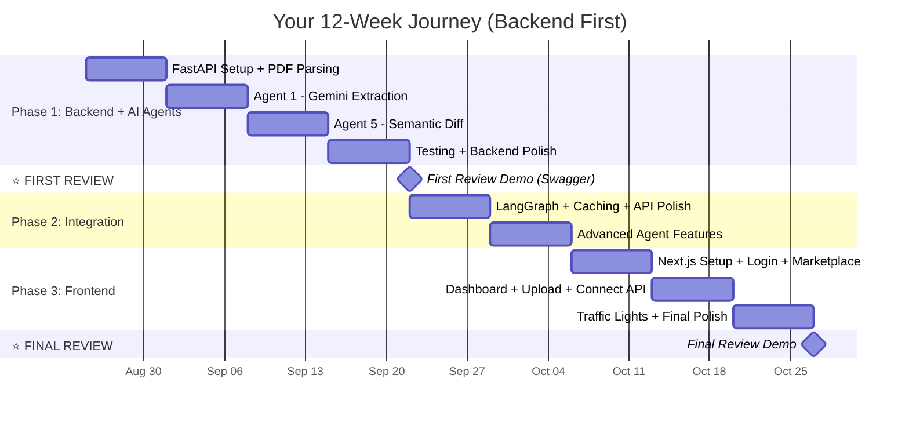

# 🗓️ 12-Week Execution Roadmap — Backend First, Frontend Last

> **Strategy:** Build the AI brain first → prove it works via Swagger → build the pretty face last.

---

## The Big Picture



| Phase | Weeks | What You're Doing |
|---|---|---|
| 🧠 **Phase 1** | 1–4 | Backend + AI Agents → **⭐ First Review** |
| 🔗 **Phase 2** | 5–6 | Integration + Advanced features |
| 🎨 **Phase 3** | 7–9 | Frontend (build fast, connect to working backend) |

---

## PHASE 1: Build the AI Brain (Weeks 1–4)

Everything is Python. You test via Swagger UI (`localhost:8000/docs`) — no frontend needed.

---

### 📅 Week 1 — FastAPI Backend + PDF Parsing

**Goal:** A running Python server that accepts a PDF and returns its text.

| Day | What You Do | Files You Create |
|---|---|---|
| **Mon** | Create `backend/` folder. Set up virtual env: `python -m venv .venv`. Create `requirements.txt`. Install FastAPI + Uvicorn. Write `main.py` with `/health` endpoint. Run `uvicorn main:app --reload`. Visit `localhost:8000/docs`. | `main.py`, `requirements.txt` |
| **Tue** | Create folder structure: `agents/`, `models/`, `routers/`, `services/`. Add `__init__.py` in each. Add CORS middleware to `main.py`. | Folder structure |
| **Wed** | Write **Pydantic schemas** — define `ExtractionResult`, `TenderRule` models. These are the JSON shapes your API will return. | `models/schemas.py` |
| **Thu** | Install PyMuPDF (`pip install PyMuPDF`). Write `extract_text_from_pdf(file_bytes) -> str`. Test with a sample PDF — print extracted text to terminal. | `services/pdf_service.py` |
| **Fri** | Build **`POST /api/extract`** endpoint. Accept PDF upload (`UploadFile`) → call `pdf_service` → return raw text as JSON. Test via Swagger UI (upload a PDF, see text come back). | `routers/extract.py` |
| **Sat** | Get **Gemini API Key** from [aistudio.google.com](https://aistudio.google.com). Create `.env` with `GEMINI_API_KEY=xxx`. Write a test script: send "Hello" to Gemini → print response. Confirm API works. | `.env`, `.env.example`, test script |

> **🎯 Week 1 Demo:** Open Swagger → upload PDF → get raw text back. Gemini API responds to test prompt. ✅

---

### 📅 Week 2 — Agent 1: The PDF Reader AI

**Goal:** Upload PDF → get structured JSON with EMD, turnover, deadline extracted by Gemini.

| Day | What You Do | Files You Touch |
|---|---|---|
| **Mon** | Write **`services/gemini_service.py`** — a function that sends text + Pydantic schema to Gemini. Use `response_mime_type: "application/json"` + `response_schema` to force structured output. | `services/gemini_service.py` |
| **Tue** | Write the **extraction prompt**: "You are a Government Tender Analyst. Extract: EMD amount, turnover requirement, experience years, deadline, certifications, eligible categories..." Test with sample text. | `agents/compliance_copilot.py` |
| **Wed** | Handle **long documents** — if text > 30K chars, chunk into ~8K segments. Send each chunk to Gemini. Merge results (combine all rules, deduplicate). | `agents/compliance_copilot.py` |
| **Thu** | Wire it end-to-end: **`/api/extract`** now does: upload PDF → extract text → send to Gemini → return `ExtractionResult` JSON. Test with a real tender PDF. | `routers/extract.py` |
| **Fri** | **Prompt iteration** — download 2-3 real tenders from [GeM portal](https://gem.gov.in). Test Agent 1 on each. Tweak the prompt until it reliably extracts the right values. | `agents/compliance_copilot.py` |
| **Sat** | Add **error handling** — corrupted PDF, empty PDF, Gemini timeout, invalid response. Return proper HTTP error codes (400, 422, 500). | `routers/extract.py`, `agents/compliance_copilot.py` |

> **🎯 Week 2 Demo:** Upload a real 50-page tender PDF → get back:
> ```json
> {
>   "tender_title": "Supply of Office Furniture",
>   "emd_amount": 50000,
>   "min_turnover": 5000000,
>   "submission_deadline": "2026-08-10",
>   "summary": "This tender requires ₹50,000 EMD and 3 years experience..."
> }
> ```
> **This is the heart of your entire project.** ✅

---

### 📅 Week 3 — Agent 5: The Cheat Detector

**Goal:** Upload two PDFs → get the exact sentences that were maliciously changed.

| Day | What You Do | Files You Touch |
|---|---|---|
| **Mon** | Install `sentence-transformers` + `nltk`. Write test script: encode 3 sentences → print cosine similarity. Verify it works on your CPU (no GPU needed). | Test script |
| **Tue** | Write **`agents/semantic_diff.py`** — core function: takes two texts → splits into sentences → encodes with `all-MiniLM-L6-v2` → pairwise cosine similarity → flags low-score pairs. | `agents/semantic_diff.py` |
| **Wed** | Create **test data** — write a short "original tender" text and a "tampered" version (manually change EMD from ₹50K to ₹5K, change deadline, etc.). Run diff. Verify it catches the changes. | Test data files |
| **Thu** | Build **`POST /api/diff`** endpoint. Accept TWO file uploads. Extract text from both → call `semantic_diff` → return `DiffResult` with flagged sentences + severity levels. | `routers/diff.py` |
| **Fri** | **Tune the threshold** — test different cutoffs (0.70, 0.75, 0.80). Find the sweet spot: catches real tampering, ignores minor reformatting. | `agents/semantic_diff.py` |
| **Sat** | Add **severity classification**: HIGH (score < 0.5), MEDIUM (0.5–0.75), LOW (0.75–0.85). Add overall risk: `SAFE / SUSPICIOUS / CRITICAL`. | `agents/semantic_diff.py`, `models/schemas.py` |

> **🎯 Week 3 Demo:** Upload original + tampered PDF → get back:
> ```json
> {
>   "risk_assessment": "CRITICAL",
>   "flagged_changes": [
>     { "original": "EMD is ₹50,000", "modified": "EMD is ₹5,000", "similarity": 0.62, "severity": "HIGH" }
>   ]
> }
> ```
> **This is your "wow" feature.** ✅

---

### 📅 Week 4 — Testing + First Review Prep

**Goal:** Both agents bulletproof. Demo-ready via Swagger.

| Day | What You Do | Files You Touch |
|---|---|---|
| **Mon** | Write **pytest tests** — test PDF extraction (good PDF, bad file, empty PDF), test Gemini extraction (mock response), test semantic diff (known input → expected output). | `tests/test_extract.py`, `tests/test_diff.py` |
| **Tue** | Add **logging** — log when PDF uploaded, when Gemini called, when diff computed. Use Python's `logging` module. Helps with debugging during demo. | All backend files |
| **Wed** | Write **backend `README.md`** — install instructions, how to run, API endpoints, example `curl` commands, environment variables needed. | `backend/README.md` |
| **Thu** | Prepare **demo materials** — 2-3 real tender PDFs from GeM. One fake corrigendum with tampering. A markdown file with your demo talking points. | `docs/demo_materials/` |
| **Fri** | **Full dry run** — start server → upload PDF → show extracted JSON → upload two PDFs for diff → show flagged sentences. Practice explaining what each API does. Time it (under 5 minutes). | — |
| **Sat** | Fix any bugs. Polish Swagger docs (add descriptions, example responses). | `main.py`, router files |

> **⭐ FIRST REVIEW — You demo via Swagger UI:**
> 1. Upload a real tender PDF → show structured JSON rules
> 2. Upload original + corrigendum → show flagged manipulations
> 3. Show test results passing
>
> **No frontend needed. The AI speaks for itself.**

---

## PHASE 2: Integration + Advanced Features (Weeks 5–6)

---

### 📅 Week 5 — LangGraph Integration + Caching

| Day | What You Do | Files You Touch |
|---|---|---|
| **Mon** | **Export agents as standalone functions** — make sure `extract_tender_rules(pdf_bytes)` and `compute_semantic_diff(text1, text2)` can be called without FastAPI (pure Python functions). | `agents/compliance_copilot.py`, `agents/semantic_diff.py` |
| **Tue** | Work with **Suriya** — register your functions as tools in the LangGraph `StateGraph`. Test: orchestrator sends a PDF → your Agent 1 returns rules. | Pair programming session |
| **Wed** | Add **response caching** — if the same PDF was already processed, return cached result. Use a simple dict or SQLite. Hash the PDF content as the cache key. | `services/cache_service.py` |
| **Thu** | Add **input validation** — max file size 10MB, only accept PDFs (check MIME type with `python-magic`), proper error codes (413, 415, 422). | `routers/extract.py`, `routers/diff.py` |
| **Fri** | **Compliance comparison logic** — write a Python function: takes user profile (turnover, certs, category) + extracted rules → returns RED/GREEN per rule with reasons. | `agents/compliance_checker.py` |
| **Sat** | Build **`POST /api/compliance`** endpoint — accepts user profile JSON + tender_id → runs comparison → returns traffic light results. | `routers/compliance.py`, `models/schemas.py` |

---

### 📅 Week 6 — Advanced Agent Features

| Day | What You Do | Files You Touch |
|---|---|---|
| **Mon** | **RAG improvement** — instead of sending raw chunks to Gemini, use sentence-transformers to find the most relevant chunks first. Only send relevant sections. Better accuracy, less tokens. | `agents/compliance_copilot.py` |
| **Tue** | Add **Q&A capability** — new endpoint `POST /api/ask` where user asks a question about a processed tender (e.g., "What is the deadline?"). Search extracted rules → answer via Gemini. | `routers/chat.py` |
| **Wed** | Add **multi-language support** — tell Gemini to also return `summary_hindi` (Hindi translation of the plain-English summary). Useful for rural MSME users. | `models/schemas.py`, `agents/compliance_copilot.py` |
| **Thu** | **Integration test** — one script that: uploads PDF → extracts rules → creates profile → checks compliance → asks a question → runs diff. All automated, all passing. | `tests/test_integration.py` |
| **Fri** | Polish all Swagger docs — professional descriptions, example responses, proper tags. Backend is now fully production-ready. | `main.py`, all routers |
| **Sat** | **Update README** — document all endpoints, new features, architecture. Commit everything to GitHub. | `README.md` |

> **🎯 Week 6 Demo:** Backend has 5 endpoints: `/health`, `/api/extract`, `/api/diff`, `/api/compliance`, `/api/ask`. All tested. All documented.

---

## PHASE 3: Build the Face — Frontend (Weeks 7–9)

Now that your backend is rock-solid, building the frontend is fast — you know exactly what data the API returns.

> [!TIP]
> Since you mentioned using AI tools for frontend earlier — you could use **Bolt / Lovable / v0.dev** to generate the UI in 1-2 days and spend the rest connecting it to your API. OR build it manually with Next.js. Either way works because your backend is already done.

---

### 📅 Week 7 — Next.js Setup + Login + Marketplace

| Day | What You Do | Files You Create |
|---|---|---|
| **Mon** | Scaffold: `npx create-next-app@latest ./frontend --typescript --tailwind --eslint --app --src-dir --use-npm`. Run `npm run dev`. Delete boilerplate. Set up dark theme colors in `globals.css`. | `frontend/` folder |
| **Tue** | Build reusable **UI components**: `Button.tsx`, `Input.tsx`, `Card.tsx`, `Badge.tsx`. Dark theme, rounded corners, subtle gradients. | `src/components/ui/` |
| **Wed** | Build **Login page** (`/login`) — Udyam/GSTIN input, validation, save to localStorage, redirect. Build **Navbar** with logo + logout. | `src/app/login/page.tsx`, `Navbar.tsx` |
| **Thu** | Build **`TenderCard`** component + mock tender data (5-6 fake tenders). Build **Marketplace page** (`/marketplace`) — grid of cards, search bar, category filters. | `TenderCard.tsx`, `src/app/marketplace/page.tsx` |
| **Fri** | Install `axios`. Create **`src/lib/api.ts`** — real API calls to your FastAPI backend (`uploadPDF`, `runDiff`, `checkCompliance`, `askQuestion`). | `src/lib/api.ts` |
| **Sat** | Test: Login → see Marketplace → filter tenders → click "Analyze" → navigate to Dashboard (empty for now). | — |

---

### 📅 Week 8 — Dashboard + Upload + Connect to Backend

| Day | What You Do | Files You Touch |
|---|---|---|
| **Mon** | Install `react-dropzone`. Build **`FileDropzone`** component — drag & drop PDF, show file name + size. Build **Dashboard page** layout (left: upload, right: results). | `FileDropzone.tsx`, `src/app/dashboard/page.tsx` |
| **Tue** | Build **`ComplianceReport`** + **`RuleCard`** components — display each extracted rule. Wire to real API: upload PDF → call `/api/extract` → display results. | `ComplianceReport.tsx`, `RuleCard.tsx` |
| **Wed** | Add **Traffic Light indicators** 🟢🔴🟡 — call `/api/compliance` with user profile → color each rule card based on eligibility. Show overall score with progress bar. | `RuleCard.tsx`, `ComplianceReport.tsx` |
| **Thu** | Build **`SemanticDiffViewer`** — two-file upload, side-by-side display, flagged sentences highlighted in red/orange/yellow. Connect to `/api/diff`. | `SemanticDiffViewer.tsx` |
| **Fri** | Add **toast notifications** (install `sonner`) — success/error toasts. Add loading skeletons. Add "Why am I rejected?" text under RED rules. | Various files |
| **Sat** | **End-to-end test:** Login → Marketplace → Upload real PDF → See real AI-extracted rules → Traffic lights → Diff two PDFs → See flagged sentences. | — |

> **🎯 Week 8 Demo:** The complete app works end-to-end with real AI. Upload a PDF on the website → see extracted rules with 🟢🔴 indicators.

---

### 📅 Week 9 — Final Polish + Final Review

| Day | What You Do | Files You Touch |
|---|---|---|
| **Mon** | **UI animations** — fade-in for cards, slide-up for results, loading pulse. Smooth page transitions. Make it feel premium. | CSS + components |
| **Tue** | **Responsive design** — test mobile view, fix layouts. Ensure consistent dark mode everywhere. | Tailwind classes |
| **Wed** | Write **project `README.md`** — what it does, architecture diagram, how to run, screenshots. Write **`docs/demo_script.md`** with exact demo steps. | `README.md`, `docs/demo_script.md` |
| **Thu** | **Full dry run** — run both servers, clear all data, do the complete demo flow. Fix any bugs. Take screenshots for your report. | — |
| **Fri** | **Rehearse demo** 2-3 times. Time it (aim for 10 minutes). Prepare backup (screen recording of a successful run, in case live demo crashes). | — |
| **Sat** | **⭐ FINAL REVIEW** | — |

> **Final Demo Flow:** Login → Marketplace → Select Tender → Upload 100-page PDF → AI extracts rules (10 sec) → Traffic Lights show 3/5 eligible (60%) → Diff tab → Upload original + corrigendum → 3 flagged manipulations → "CRITICAL RISK" 🔴

---

## Quick Reference

| Week | Language | What You're Building |
|---|---|---|
| **1** | Python | FastAPI skeleton + PDF text extraction |
| **2** | Python | **Agent 1** — Gemini reads PDFs → JSON rules |
| **3** | Python | **Agent 5** — Cosine similarity cheat detector |
| **4** | Python | Testing + **⭐ First Review** (Swagger demo) |
| **5** | Python | LangGraph integration + caching + compliance API |
| **6** | Python | RAG improvement + Q&A + Hindi summaries |
| **7** | TypeScript | Next.js setup + Login + Marketplace |
| **8** | TypeScript | Dashboard + Upload + Connect to API |
| **9** | Both | Polish + **⭐ Final Review** |

---

> [!TIP]
> **The beauty of this order:** By the time you start frontend (Week 7), your backend already works perfectly. You just connect the wires. No guessing what the API returns — you've been testing it for 6 weeks via Swagger.
