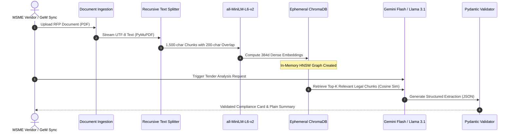

# Generative AI Components & Architectural Reasoning

**Project Scope:** Module 1 (MSME Copilot & Tender Intelligence), Module 2 (Legal & Dispute Automation), and MSME Ingestion Pipelines.  
**Author / Contributor Scope:** Solely covering Generative AI systems designed and implemented for the User's subsystem.  
**Classification:** Deep-Dive Technical Architecture & AI Safety Specification.

---

## 1. Executive Summary: The Role of Generative AI

In the **ProcureGuard-AI** platform, Generative AI (GenAI) is utilized as a high-speed **cognitive perception and synthesis layer**, rather than an autonomous decision-maker.

Public procurement tenders published on the **Government e-Marketplace (GeM)** and the **Central Public Procurement Portal (CPPP)** are notoriously complex:
* They span between 40 and 200 pages of dense bureaucratic legalese.
* Crucial qualification criteria (turnover thresholds, earnest money deposit exemptions, local content percentages) are scattered across dozens of annexures and corrigenda.
* Small MSME vendors lack in-house legal and bid consulting teams to decipher these documents within narrow bidding windows.

Generative AI bridges this capability gap by:
1. **Synthesizing massive RFPs** into structured, readable executive summaries in seconds.
2. **Extracting strict numerical eligibility criteria** and mapping them directly to the MSME's profile.
3. **Translating bureaucratic English and Hindi** into plain, accessible vernacular language.
4. **Drafting formal statutory legal notices** under Section 16 of the MSMED Act, 2006.

---

## 2. Architectural Boundaries: Neurosymbolic Division of Labor

To prevent dangerous hallucinations (e.g., misreading financial penalties or inventing fake tender dates), the system enforces a strict architectural boundary between **Generative AI** and **Deterministic Code**:

```
┌────────────────────────────────────────────────────────────────────────┐
│                   UNSTRUCTURED GOVERNMENT TENDER RFP                    │
└───────────────────────────────────┬────────────────────────────────────┘
                                    │
                                    ▼
┌────────────────────────────────────────────────────────────────────────┐
│              GENERATIVE AI LAYER (LLM + Ephemeral RAG)                 │
│                                                                        │
│  ✔ Unstructured-to-Structured Extraction (Dates, Clauses, Annexures)  │
│  ✔ Multi-lingual & Vernacular Translation (Hindi / Marathi / English)  │
│  ✔ Legalese-to-Plain-English Simplification                            │
│  ✔ Narrative Legal Notice Draft Synthesis                              │
└───────────────────────────────────┬────────────────────────────────────┘
                                    │ Outputs Strict Pydantic JSON
                                    ▼
┌────────────────────────────────────────────────────────────────────────┐
│             SYMBOLIC / DETERMINISTIC VERIFICATION LAYER               │
│                                                                        │
│  ✖ Zero LLM Math (MSMED Act 3x RBI Interest calculated via formula)    │
│  ✖ Zero LLM Bid Decision (Go / No-Go calculated via weighted matrix)   │
│  ✖ Grounded Citation Verification (Regex checks text against PDF page) │
│  ✖ Statutory Compliance Rules (Public Procurement Policy 2012)        │
└────────────────────────────────────────────────────────────────────────┘
```

---

## 3. Ephemeral Retrieval-Augmented Generation (RAG) Architecture

### 3.1. Why "Ephemeral" RAG Instead of a Single Global Vector Database?
Traditional enterprise RAG designs maintain a monolithic vector database where all documents are continuously ingested. In public procurement, this architecture suffers from **Cross-Tender Contamination**:
* If Tender A (Ministry of Defence, 2024) and Tender B (Indian Railways, 2026) are stored in the same global index, semantic queries for *"What is the Earnest Money Deposit?"* frequently retrieve chunks from the wrong tender.
* Every tender is a legally isolated contract. Cross-document contamination creates catastrophic false claims.

**Our Design: Session-Scoped Ephemeral RAG**
* Each uploaded tender triggers an in-memory, session-isolated vector collection in **ChromaDB**.
* Dense embeddings are generated on-the-fly using `all-MiniLM-L6-v2`.
* Once analysis, extraction, and verification are complete, the structured entities are stored in the relational database (`SQLAlchemy` / PostgreSQL), and the ephemeral vector space is safely deallocated.

### 3.2. RAG Pipeline Step-by-Step



---

## 4. Prompt Engineering & Grounding Safeguards

All system prompts in the platform follow the **Triple-Constraint Prompt Engineering Standard**:
1. **Persona & Domain Specialization:** Fixes the model into an adversarial compliance auditor.
2. **Context-Only Grounding (Closed-World Assumption):** Explicitly forbids extrapolating or guessing missing information.
3. **Schema-Enforced Output Contract:** Enforces strict JSON return types.

### Exemplary System Prompt (Tender Entity Extractor)
```text
You are an expert Indian Government Public Procurement Compliance Officer specializing in the 
Public Procurement Policy for Micro and Small Enterprises (MSEs) Order, 2012, GeM General Contract 
Conditions (GCC), and CPPP Guidelines.

Your task is to analyze the provided tender excerpts and extract qualification parameters.

CRITICAL INSTRUCTIONS:
1. GROUNDING RULE: Extract information ONLY if explicitly stated in the context excerpts. 
   If a criterion is absent, set its value to null. NEVER extrapolate or guess.
2. CITATION REQUIREMENT: For every extracted requirement, you MUST provide the exact Page Number 
   or Clause Heading where the text appears.
3. MSME EXEMPTION IDENTIFICATION: Check specifically whether Prior Turnover and Prior Experience 
   criteria are exempted for registered Micro & Small Enterprises (MSEs) under Rule 173(i) of GFR 2017.
4. OUTPUT FORMAT: Respond ONLY with valid, raw RFC 8259 JSON matching the requested schema. 
   Do not include preamble, conversational greetings, or markdown code fence backticks.
```

---

## 5. Structured Outputs & Pydantic Schema Validation

Large language models natively generate non-deterministic natural language strings. In production software, downstream microservices, databases, and UI components cannot consume unstructured prose.

Every GenAI call in the platform is coupled with a **Pydantic V2 Data Contract**:

```python
class TenderComplianceSchema(BaseModel):
    tender_id: str = Field(description="Unique GeM / CPPP tender reference ID")
    organization_name: str = Field(description="Issuing Ministry, PSU, or Department")
    estimated_value_inr: Optional[float] = Field(description="Estimated procurement value in INR")
    emd_amount_inr: Optional[float] = Field(description="Earnest Money Deposit required")
    msme_emd_exemption: bool = Field(description="True if MSEs are exempt from EMD")
    min_annual_turnover_inr: Optional[float] = Field(description="Minimum required 3-year turnover")
    msme_turnover_exemption: bool = Field(description="True if MSE turnover waiver applies")
    required_certifications: List[str] = Field(description="List of mandatory ISO/BIS certifications")
    submission_deadline: Optional[str] = Field(description="Bid submission closing timestamp")
    onerous_clauses_detected: List[str] = Field(description="Biased or anti-MSME clauses")
    source_citations: Dict[str, str] = Field(description="Key-value mapping of field to page citation")
    confidence_score: float = Field(ge=0.0, le=1.0, description="Model certainty score")
```

### Self-Healing JSON Parser
When an LLM inadvertently returns markdown wrappings (e.g., ````json { ... } ````) or minor trailing comma syntax bugs, our custom `repair_and_parse_json` utility strips outer artifacts, parses the core token buffer, and validates field types before persistence.

---

## 6. Vernacular & Plain-Language Translation Subsystem

### 6.1. The MSME Accessibility Problem
Over 85% of India's 63 million MSMEs operate outside tier-1 metropolitan centers, where business proprietors are most comfortable operating in regional languages (such as Hindi, Marathi, Tamil, or Gujarati). However, standard central government RFPs are drafted in dense English legalese filled with complex Latinate terminology:
* *"Liquidated damages shall accrue pari passu with delay schedules pursuant to clause 14.1..."*
* *"In witness whereof the concessionaire indemnifies the procurer against all third-party tortious claims..."*

### 6.2. The Plain-Language Transformation Engine
The simplifier agent processes every dense clause through a two-stage cognitive pipeline:

```
[ Complex Legalese Clause ]
             │
             ▼
[ Stage 1: Semantic Deconstruction (Gemini Flash) ]
   - Identifies the Obligation (What the MSME must do)
   - Identifies the Risk / Penalty (What happens if delayed)
   - Identifies the Exemption (Does MSMED Act override this?)
             │
             ▼
[ Stage 2: Plain-Language & Vernacular Generation ]
   - English: "Warning: If your delivery is delayed by even 1 day, the buyer will 
     deduct 0.5% per week up to 10% maximum from your final bill."
   - Hindi (हिन्दी): "सावधान: यदि डिलीवरी में 1 दिन की भी देरी होती है, तो खरीदार 
     आपके अंतिम बिल से प्रति सप्ताह 0.5% (अधिकतम 10% तक) काट लेगा।"
```

---

## 7. Automated Legal Notice Draft Generation

### 7.1. Statutory Legal Grounds
When government buyers or large corporate procurers delay payments beyond 45 days, MSMEs rarely possess the financial resources to engage high-cost litigation counsel. The platform includes a Generative AI **Legal Notice Synthesizer** that prepares formal, legally admissible demand letters under **Section 16 & 17 of the MSMED Act, 2006**.

### 7.2. Neurosymbolic Assembly Pipeline
To ensure legal validity before the **MSEFC (Micro and Small Enterprises Facilitation Council)**, the letter is synthesized via a hybrid assembly technique:

1. **Deterministic Data Insertion (Non-AI):**
   * Vendor Udyam Registration Number.
   * Buyer GSTIN and Corporate Identification Number (CIN).
   * Exact Invoice numbers, dates, and principal amounts.
   * Statutory Compound Interest calculated down to the paise by the RBI compounding formula.
2. **Generative Narrative Synthesis (GenAI):**
   * Drafts the factual chronology of delivery, supply acceptance, and past reminder correspondences.
   * Frames the formal legal invocation citing statutory precedents (e.g., Supreme Court rulings upholding overriding effect of Section 24 of MSMED Act).
   * Generates a 15-day cure notice deadline before formal filing on the **MSME Samadhaan Portal**.

---

## 8. Hallucination Mitigation & Confidence Scoring Matrix

To ensure system trustworthiness, every output is evaluated across a 4-layer validation matrix:

| Layer | Defense Mechanism | Action on Failure |
| :--- | :--- | :--- |
| **1. Grounding Anchor** | Model must output exact page/clause citations for every claim. | If citation is missing or invalid, claim is flagged as unverified (Yellow warning). |
| **2. Deterministic Verification** | Extracted numerical criteria (e.g., Turnover ₹50 Lakh) are cross-checked against PDF text via fast regex. | Overrides model output with deterministic string match. |
| **3. Numerical Sanity Check** | Verifies that dates are logically ordered (`submission_date > published_date`). | If dates are temporally inverted, raises critical validation error. |
| **4. Confidence Scoring** | Evaluates a composite metric: $$C = 0.4 \times S_{retrieval} + 0.3 \times P_{citation} + 0.3 \times V_{schema}$$ | Output with $C < 0.70$ is routed to Human-in-the-Loop review. |

```
Confidence Score Scale:
┌───────────────────────────┬───────────────────────────┬──────────────────────────┐
│  0.0 ────────────── 0.69  │  0.70 ───────────── 0.84  │  0.85 ───────────── 1.0  │
│      Low Confidence       │    Moderate Confidence    │     High Confidence      │
│  Requires Manual Audit    │   Highlighted for Review  │   Direct Auto-Approval   │
└───────────────────────────┴───────────────────────────┴──────────────────────────┘
```

This ensures that the Generative AI engine serves as an empowering assistant for MSMEs while guaranteeing absolute legal and arithmetic safety.
