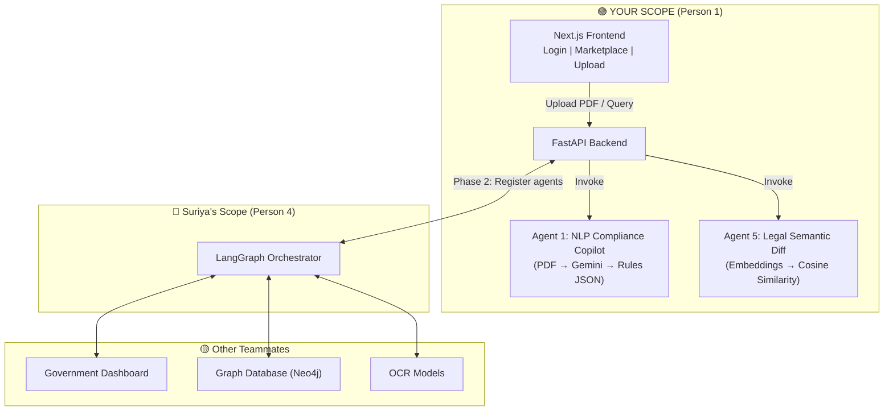
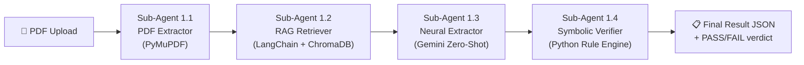
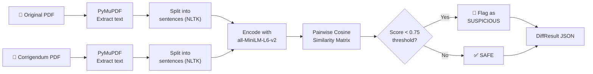

# Intelligent Procurement Integrity Platform — MSME Copilot

## Your Role

You are **Person 1** on a 4-person team. You own:

| Module | What It Does |
|---|---|
| **MSME Frontend** | Next.js + TailwindCSS web app (Login, Marketplace, Upload, Dashboard) |
| **Agent 1 — NLP Compliance Copilot** | RAG-based PDF extraction → structured rules via Gemini API |
| **Agent 5 — Legal Semantic Diff** | Cosine similarity on embeddings to detect malicious tender amendments |

**You are NOT building:** Government Dashboard, Graph Database, OCR models (teammates handle those).

---

## System Architecture



---

## Technology Stack

### Frontend

| Package | Version | Purpose |
|---|---|---|
| `next` | 15.x | React framework with App Router |
| `react` / `react-dom` | 19.x | UI library |
| `tailwindcss` | v4 | Utility-first CSS (CSS-first config in v4) |
| `axios` | latest | HTTP client to call FastAPI |
| `react-dropzone` | latest | Drag-and-drop PDF upload |
| `lucide-react` | latest | Modern icon library |
| `sonner` | latest | Toast notifications |

### Backend

| Package | Version | Purpose |
|---|---|---|
| `fastapi` | 0.115+ | Async REST API framework |
| `uvicorn[standard]` | latest | ASGI server |
| `python-multipart` | latest | File upload handling |
| `google-genai` | latest | Gemini API SDK (new unified SDK) |
| `PyMuPDF` (fitz) | latest | PDF text extraction |
| `pydantic` | v2 | Request/response schemas |
| `sentence-transformers` | latest | Embeddings for Agent 5 (all-MiniLM-L6-v2) |
| `python-dotenv` | latest | `.env` file loading |
| `python-magic-bin` | latest | MIME type validation (Windows) |

### API Keys Required

| Service | How to Get | Cost |
|---|---|---|
| **Gemini API** | [Google AI Studio](https://aistudio.google.com) → Create API Key | ✅ Free (15 RPM, 1M tokens/day) |

> [!TIP]
> **Total cost: ₹0.** Gemini free tier + sentence-transformers (runs locally) = zero spend.

---

## Phase 1 — MVP Core (First Review)

### Task 1: Scaffold Next.js Frontend

**Command:**
```bash
npx -y create-next-app@latest ./ --typescript --tailwind --eslint --app --src-dir --import-alias "@/*" --use-npm
```

**Resulting Structure:**
```
frontend/
├── src/
│   ├── app/
│   │   ├── layout.tsx            # Root layout (fonts, metadata)
│   │   ├── page.tsx              # Landing / redirect to login
│   │   ├── globals.css           # TailwindCSS v4 imports
│   │   ├── login/
│   │   │   └── page.tsx          # Udyam / GSTIN login
│   │   ├── marketplace/
│   │   │   └── page.tsx          # Browse tenders
│   │   └── dashboard/
│   │       └── page.tsx          # Upload PDF + view results
│   ├── components/
│   │   ├── ui/                   # Reusable UI primitives
│   │   │   ├── Button.tsx
│   │   │   ├── Card.tsx
│   │   │   ├── Input.tsx
│   │   │   ├── Badge.tsx
│   │   │   └── StatusIndicator.tsx  # 🟢🔴🟡 traffic light
│   │   ├── FileDropzone.tsx      # PDF drag-and-drop
│   │   ├── ComplianceReport.tsx  # Display extracted rules
│   │   ├── TenderCard.tsx        # Marketplace tender card
│   │   ├── Navbar.tsx            # Top navigation bar
│   │   └── Sidebar.tsx           # Dashboard sidebar
│   ├── lib/
│   │   └── api.ts                # Axios client (baseURL → FastAPI)
│   └── types/
│       └── index.ts              # TypeScript interfaces
├── public/
├── next.config.ts
├── tailwind.config.ts
├── tsconfig.json
└── package.json
```

---

### Task 2: Build UI Screens

#### Screen 1 — Login (`/login`)
- Input fields: **Udyam Number** (e.g. `UDYAM-MH-01-0012345`) or **GSTIN** (e.g. `27AABCS1429B1Z5`)
- Simple validation (regex pattern match)
- On submit → store in localStorage / context → redirect to `/marketplace`
- No backend auth needed for MVP (just profile storage)

#### Screen 2 — Tender Marketplace (`/marketplace`)
- Grid of `TenderCard` components showing:
  - Tender title, deadline, EMD amount, category
  - "Analyze" button → navigates to `/dashboard?tender_id=xxx`
- For MVP: hardcoded mock tender data (3-5 tenders)
- Phase 2: fetch from API / other team's database

#### Screen 3 — Dashboard (`/dashboard`)
- Left panel: `FileDropzone` for PDF upload
- Right panel: `ComplianceReport` showing extracted rules
- Flow: Upload PDF → POST to `/api/extract` → display JSON as formatted cards
- Each rule shows a traffic light indicator (Phase 2 polish)

---

### Task 3: Build FastAPI Backend Skeleton

**Structure:**
```
backend/
├── main.py                       # FastAPI app entry point + CORS
├── requirements.txt              # All Python dependencies
├── .env                          # GEMINI_API_KEY (gitignored)
├── .env.example                  # Template for teammates
├── agents/
│   ├── __init__.py
│   ├── compliance_copilot.py     # Agent 1 — PDF extraction logic
│   └── semantic_diff.py          # Agent 5 — Cosine similarity
├── models/
│   ├── __init__.py
│   └── schemas.py                # Pydantic request/response models
├── routers/
│   ├── __init__.py
│   ├── extract.py                # POST /api/extract (Agent 1)
│   └── diff.py                   # POST /api/diff   (Agent 5)
├── services/
│   ├── __init__.py
│   ├── pdf_service.py            # PyMuPDF text extraction
│   └── gemini_service.py         # Gemini API wrapper
├── uploads/                      # Temp PDF storage (gitignored)
└── tests/
    ├── __init__.py
    ├── test_extract.py
    └── test_diff.py
```

**`main.py` core:**
```python
from fastapi import FastAPI
from fastapi.middleware.cors import CORSMiddleware
from routers import extract, diff

app = FastAPI(
    title="MSME Copilot API",
    version="1.0.0",
    description="NLP Compliance Copilot & Semantic Diff Agent"
)

app.add_middleware(
    CORSMiddleware,
    allow_origins=["http://localhost:3000"],  # Next.js dev server
    allow_credentials=True,
    allow_methods=["*"],
    allow_headers=["*"],
)

app.include_router(extract.router, prefix="/api", tags=["Agent 1"])
app.include_router(diff.router, prefix="/api", tags=["Agent 5"])

@app.get("/health")
async def health():
    return {"status": "ok"}
```

---

### Task 4: Build Agent 1 (NLP Compliance Copilot) — 4 Sub-Agents

Agent 1 is NOT a single script — it's a pipeline of **4 sub-agents** that work in sequence:



#### Sub-Agent 1.1: PDF Extractor
**File:** `agents/sub_agents/pdf_extractor.py`
**Tech:** PyMuPDF (fitz)
**What it does:** Extracts raw text from uploaded Tender PDFs, page by page.
```python
import fitz  # PyMuPDF

def extract_text_from_pdf(pdf_bytes: bytes) -> str:
    """Extract all text from a PDF file."""
    doc = fitz.open(stream=pdf_bytes, filetype="pdf")
    text = ""
    for page in doc:
        text += page.get_text()
    doc.close()
    return text
```

#### Sub-Agent 1.2: RAG Retriever
**File:** `agents/sub_agents/rag_retriever.py`
**Tech:** LangChain + ChromaDB + Gemini Embeddings (`text-embedding-004`)
**What it does:** Chunks the extracted text, embeds it into a vector store (ChromaDB), and retrieves the most relevant chunks when queried for specific rules.
```python
from langchain_text_splitters import RecursiveCharacterTextSplitter
from langchain_chroma import Chroma
from langchain_google_genai import GoogleGenerativeAIEmbeddings

def build_vector_store(raw_text: str) -> Chroma:
    """Chunk text and store embeddings in ChromaDB."""
    splitter = RecursiveCharacterTextSplitter(
        chunk_size=2000,
        chunk_overlap=200,
        separators=["\n\n", "\n", ". ", " "]
    )
    chunks = splitter.split_text(raw_text)
    embeddings = GoogleGenerativeAIEmbeddings(model="models/text-embedding-004")
    vectorstore = Chroma.from_texts(chunks, embedding=embeddings)
    return vectorstore

def retrieve_relevant_chunks(vectorstore: Chroma, query: str, k: int = 5) -> str:
    """Retrieve the top-k most relevant chunks for a query."""
    docs = vectorstore.similarity_search(query, k=k)
    return "\n\n".join([doc.page_content for doc in docs])
```
**Why RAG?** A 100-page tender PDF has ~50K tokens. Gemini's context window can handle it, but RAG gives **more accurate extraction** by focusing on the most relevant sections instead of drowning the LLM in irrelevant text.

#### Sub-Agent 1.3: Neural Extractor
**File:** `agents/sub_agents/neural_extractor.py`
**Tech:** Gemini API (Zero-Shot Structured Output)
**What it does:** Takes the relevant chunks from the RAG Retriever and uses Gemini to extract structured compliance rules.

**Zero-Shot Prompt Template:**
```
You are a Government Tender Analysis Agent for Indian MSMEs.

Given the following text extracted from a Government tender/RFP document,
extract ALL mandatory compliance rules.

Focus on extracting:
1. EMD (Earnest Money Deposit) amount
2. Minimum annual turnover requirement
3. Minimum years of experience
4. Required certifications (ISO, Udyam, etc.)
5. Submission deadline
6. Eligible MSME categories (Micro/Small/Medium)
7. Required documents for submission
8. Any special exemptions for MSME enterprises
9. Ministry, Department, and Organisation details
10. Tender type (Supply/Works/Services/Consultancy)

Return ONLY the structured JSON matching the provided schema.

--- TENDER TEXT ---
{retrieved_chunks}
```

#### Sub-Agent 1.4: Symbolic Verifier
**File:** `agents/sub_agents/symbolic_verifier.py`
**Tech:** Custom Python Rule Engine (zero hallucination)
**What it does:** Takes the Gemini-extracted rules AND the MSME user's profile, then runs hard-coded Python comparisons to produce a PASS/FAIL verdict for each rule. **No AI here — pure deterministic logic.**
```python
def verify_compliance(extracted_rules: dict, msme_profile: dict) -> dict:
    """Compare extracted tender rules against MSME profile. Pure Python, no AI."""
    results = []

    # Turnover check
    if extracted_rules.get("min_turnover"):
        passed = msme_profile["annual_turnover"] >= extracted_rules["min_turnover"]
        results.append({
            "rule": "Minimum Turnover",
            "required": extracted_rules["min_turnover"],
            "yours": msme_profile["annual_turnover"],
            "status": "PASS" if passed else "FAIL",
            "color": "GREEN" if passed else "RED"
        })

    # Experience check
    if extracted_rules.get("min_experience_years"):
        passed = msme_profile["experience_years"] >= extracted_rules["min_experience_years"]
        results.append({
            "rule": "Minimum Experience",
            "required": f"{extracted_rules['min_experience_years']} years",
            "yours": f"{msme_profile['experience_years']} years",
            "status": "PASS" if passed else "FAIL",
            "color": "GREEN" if passed else "RED"
        })

    # Certification check
    if extracted_rules.get("required_certifications"):
        required = set(extracted_rules["required_certifications"])
        has = set(msme_profile["certifications"])
        missing = required - has
        passed = len(missing) == 0
        results.append({
            "rule": "Certifications",
            "required": list(required),
            "yours": list(has),
            "missing": list(missing),
            "status": "PASS" if passed else "FAIL",
            "color": "GREEN" if passed else "RED"
        })

    overall = "PASS" if all(r["status"] == "PASS" for r in results) else "FAIL"
    return {"compliance": overall, "checks": results}
```

#### API Contract

**Endpoint:** `POST /api/extract`

**Request:** `multipart/form-data` with a single PDF file + optional `user_id` (to fetch MSME profile for verification)

**Response Schema (Pydantic):**
```python
from pydantic import BaseModel, Field
from typing import List, Optional

class TenderRule(BaseModel):
    """A single extracted rule from the tender document."""
    rule_name: str = Field(description="Short name of the rule")
    rule_value: str = Field(description="The value or threshold")
    category: str = Field(description="Category: EMD | Turnover | Experience | Certification | Deadline | Other")
    is_mandatory: bool = Field(description="Whether this rule is mandatory")

class ComplianceCheck(BaseModel):
    """Result of comparing one rule against MSME profile (from Sub-Agent 1.4)."""
    rule: str = Field(description="Name of the rule checked")
    required: str = Field(description="What the tender requires")
    yours: str = Field(description="What the MSME has")
    status: str = Field(description="PASS or FAIL")
    color: str = Field(description="GREEN, YELLOW, or RED")

class ExtractionResult(BaseModel):
    """Structured output from Agent 1 (all 4 sub-agents combined)."""
    # --- From Sub-Agent 1.3 (Neural Extractor) ---
    tender_id: Optional[str] = Field(description="Tender/RFP ID if found")
    tender_title: str = Field(description="Title of the tender")
    issuing_authority: Optional[str] = Field(description="Government body issuing the tender")
    submission_deadline: Optional[str] = Field(description="Last date for submission (ISO format)")
    emd_amount: Optional[float] = Field(description="Earnest Money Deposit in INR")
    min_turnover: Optional[float] = Field(description="Minimum annual turnover required in INR")
    min_experience_years: Optional[int] = Field(description="Minimum years of experience required")
    eligible_categories: List[str] = Field(description="Eligible MSME categories: Micro, Small, Medium")
    required_documents: List[str] = Field(description="List of documents required for submission")
    required_certifications: List[str] = Field(description="Certifications needed: ISO, Udyam, etc.")
    special_conditions: List[str] = Field(description="Special exemptions or conditions")
    rules: List[TenderRule] = Field(description="All extracted rules as structured list")
    summary: str = Field(description="Plain-English 3-4 sentence summary for the MSME user")

    # --- From Sub-Agent 1.3 (Department Classification) ---
    ministry: Optional[str] = Field(description="Ministry name, e.g. 'Ministry of Railways', 'PMO'")
    department: Optional[str] = Field(description="Department name, e.g. 'Department of Atomic Energy'")
    organisation: Optional[str] = Field(description="Organisation, e.g. 'Uranium Corporation of India Limited'")
    office_location: Optional[str] = Field(description="Office/city, e.g. 'Kadapa', 'New Delhi'")
    tender_type: Optional[str] = Field(description="Type: Supply | Works | Services | Consultancy")

    # --- From Sub-Agent 1.4 (Symbolic Verifier) ---
    compliance: Optional[str] = Field(description="Overall: PASS or FAIL")
    compliance_checks: Optional[List[ComplianceCheck]] = Field(description="Per-rule traffic light results")
```

> [!IMPORTANT]
> The Gemini API's **structured output** feature (`response_schema`) forces the model to return data matching your Pydantic schema exactly — no parsing needed. Use `response.parsed` to get the typed object directly.

---

## Phase 2 — Advanced AI & Polish (Final Review)

### Task 5: Build Agent 5 (Legal Semantic Diff)

#### Purpose
Detect **malicious manipulations** in tender corrigenda (amendments). Compare original tender with its corrigendum to find sentences that were semantically altered.

#### API Contract

**Endpoint:** `POST /api/diff`

**Request:** `multipart/form-data` with TWO PDF files (`original` + `corrigendum`)

**Response Schema:**
```python
class SentenceDiff(BaseModel):
    """A sentence pair showing semantic change."""
    original_sentence: str
    modified_sentence: str
    similarity_score: float = Field(description="Cosine similarity 0.0–1.0")
    change_severity: str = Field(description="HIGH | MEDIUM | LOW")
    section: Optional[str] = Field(description="Document section where change was found")

class DiffResult(BaseModel):
    """Output from Agent 5."""
    overall_similarity: float = Field(description="Average document-level similarity")
    total_sentences_compared: int
    flagged_changes: List[SentenceDiff]
    risk_assessment: str = Field(description="SAFE | SUSPICIOUS | CRITICAL")
    summary: str = Field(description="Plain-English summary of findings")
```

#### Agent 5 Processing Pipeline



#### Core Algorithm
```python
from sentence_transformers import SentenceTransformer, util
import nltk

model = SentenceTransformer('all-MiniLM-L6-v2')  # 80MB, runs on CPU

def compute_semantic_diff(original_text: str, amended_text: str, threshold=0.75):
    # 1. Split into sentences
    orig_sentences = nltk.sent_tokenize(original_text)
    amend_sentences = nltk.sent_tokenize(amended_text)
    
    # 2. Encode
    orig_embeddings = model.encode(orig_sentences, convert_to_tensor=True)
    amend_embeddings = model.encode(amend_sentences, convert_to_tensor=True)
    
    # 3. Pairwise cosine similarity
    cosine_scores = util.cos_sim(orig_embeddings, amend_embeddings)
    
    # 4. For each original sentence, find the best match in amended
    flagged = []
    for i, orig_sent in enumerate(orig_sentences):
        best_match_idx = cosine_scores[i].argmax().item()
        best_score = cosine_scores[i][best_match_idx].item()
        
        if best_score < threshold:
            flagged.append({
                "original": orig_sent,
                "modified": amend_sentences[best_match_idx],
                "score": best_score,
                "severity": "HIGH" if best_score < 0.5 else "MEDIUM"
            })
    
    return flagged
```

---

### Task 6: Polish UI/UX — Traffic Light System

Add visual compliance indicators to the Dashboard:

| Score | Color | Meaning |
|---|---|---|
| **GREEN** 🟢 | `#10B981` | Eligible — meets this requirement |
| **YELLOW** 🟡 | `#F59E0B` | Partially eligible — needs attention |
| **RED** 🔴 | `#EF4444` | Ineligible — fails this requirement |

**Implementation:** Compare extracted rules against the user's MSME profile (stored from login):
- `user.turnover >= tender.min_turnover` → 🟢 else 🔴
- `user.certifications ⊇ tender.required_certifications` → 🟢 else 🔴
- `user.category ∈ tender.eligible_categories` → 🟢 else 🔴

---

### Task 7: LangGraph Orchestrator Integration

Register Agent 1 and Agent 5 as **tool functions** in Suriya's LangGraph StateGraph:

```python
# This is what Suriya's orchestrator.py will call
from agents.compliance_copilot import extract_tender_rules
from agents.semantic_diff import compute_semantic_diff

# Your agents become "tools" in the LangGraph graph
tools = [
    {
        "name": "extract_tender_rules",
        "description": "Extract compliance rules from a tender PDF",
        "function": extract_tender_rules,
    },
    {
        "name": "compute_semantic_diff",
        "description": "Compare two tender documents for malicious changes",
        "function": compute_semantic_diff,
    },
]
```

> [!NOTE]
> For Phase 2 integration, your FastAPI endpoints remain standalone — the Orchestrator simply calls them via HTTP or imports the agent functions directly.

---

## Complete Folder Structure

```
d:\Final_year_Project\
├── frontend/                          # Task 1-2, 6
│   ├── src/
│   │   ├── app/
│   │   │   ├── layout.tsx
│   │   │   ├── page.tsx
│   │   │   ├── globals.css
│   │   │   ├── login/page.tsx
│   │   │   ├── marketplace/page.tsx
│   │   │   └── dashboard/page.tsx
│   │   ├── components/
│   │   │   ├── ui/
│   │   │   │   ├── Button.tsx
│   │   │   │   ├── Card.tsx
│   │   │   │   ├── Input.tsx
│   │   │   │   ├── Badge.tsx
│   │   │   │   └── StatusIndicator.tsx
│   │   │   ├── FileDropzone.tsx
│   │   │   ├── ComplianceReport.tsx
│   │   │   ├── TenderCard.tsx
│   │   │   ├── SemanticDiffViewer.tsx
│   │   │   ├── Navbar.tsx
│   │   │   └── Sidebar.tsx
│   │   ├── lib/
│   │   │   └── api.ts
│   │   └── types/
│   │       └── index.ts
│   ├── public/
│   ├── next.config.ts
│   ├── tailwind.config.ts
│   ├── tsconfig.json
│   └── package.json
│
├── backend/                           # Task 3-5, 7
│   ├── main.py
│   ├── requirements.txt
│   ├── .env
│   ├── .env.example
│   ├── agents/
│   │   ├── __init__.py
│   │   ├── compliance_copilot.py      # Agent 1
│   │   └── semantic_diff.py           # Agent 5
│   ├── models/
│   │   ├── __init__.py
│   │   └── schemas.py
│   ├── routers/
│   │   ├── __init__.py
│   │   ├── extract.py
│   │   └── diff.py
│   ├── services/
│   │   ├── __init__.py
│   │   ├── pdf_service.py
│   │   └── gemini_service.py
│   ├── uploads/
│   └── tests/
│       ├── __init__.py
│       ├── test_extract.py
│       └── test_diff.py
│
├── docs/
│   ├── implementation_plan.md         # This document
│   └── architecture.md               # For project report
│
├── .gitignore
└── README.md
```

---

## Build Order (Recommended)

| Order | Task | What to Build | Estimated Time |
|---|---|---|---|
| **1** | Task 3 | FastAPI backend skeleton + health endpoint | 1 hour |
| **2** | Task 4 | Agent 1 MVP — PDF → Gemini → JSON | 3-4 hours |
| **3** | Task 1 | Scaffold Next.js frontend | 30 minutes |
| **4** | Task 2 | Login + Marketplace + Dashboard UI | 4-5 hours |
| **5** | ✅ | **FIRST REVIEW CHECKPOINT** — Upload → Extract → Display works | — |
| **6** | Task 5 | Agent 5 — Semantic Diff | 3-4 hours |
| **7** | Task 6 | Traffic Light UI polish | 2-3 hours |
| **8** | Task 7 | LangGraph integration with Suriya | 2-3 hours |
| **9** | ✅ | **FINAL REVIEW CHECKPOINT** — Full polished system | — |

> [!IMPORTANT]
> **Start with the backend (Task 3 → Task 4).** This lets you test Agent 1 via Postman immediately, without waiting for the frontend to be ready.

---

## Prerequisites Checklist

| Requirement | Check |
|---|---|
| **Python 3.11+** installed | `python --version` |
| **Node.js 20+** installed | `node --version` |
| **npm** installed | `npm --version` |
| **Gemini API Key** obtained | [aistudio.google.com](https://aistudio.google.com) |
| **Git** installed | `git --version` |
| **VS Code** with Python + ESLint extensions | — |

---

## Verification Plan

### Phase 1 Verification (First Review)
1. **Backend standalone:** `curl -F "file=@tender.pdf" http://localhost:8000/api/extract` → returns valid JSON
2. **Frontend → Backend:** Upload PDF on Dashboard → see extracted rules rendered as cards
3. **Error handling:** Upload a non-PDF file → get proper error response

### Phase 2 Verification (Final Review)
1. **Semantic Diff:** Upload original + corrigendum → flagged sentences displayed with severity colors
2. **Traffic Light:** Login with test MSME profile → extract tender → see 🟢🔴🟡 indicators per rule
3. **Integration:** Suriya's Orchestrator can call your Agent 1 and Agent 5 functions

---

## Open Questions

> [!IMPORTANT]
> **Q1**: Do you have your **Gemini API Key** ready, or should we set it up first?

> [!IMPORTANT]
> **Q2**: Do you have a **sample Government tender PDF** (from GeM or similar) for testing? If not, I can help create a realistic mock PDF.

> [!IMPORTANT]
> **Q3**: Should we start building now? I recommend: **Backend first (Task 3 → Task 4)**, then Frontend.
