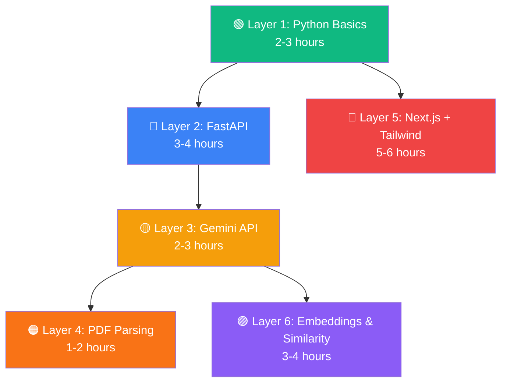

# Learning Roadmap — MSME Copilot Prerequisites

> **Goal:** Learn just enough to start building. Don't study everything first — learn a concept, then immediately apply it in the project.

---

## At a Glance



| Layer | Concept | Priority | When You Need It |
|---|---|---|---|
| 1 | Python Fundamentals | 🔴 MUST | Everything backend |
| 2 | FastAPI | 🔴 MUST | Task 3 (backend skeleton) |
| 3 | Gemini API | 🔴 MUST | Task 4 (Agent 1) |
| 4 | PDF Parsing | 🔴 MUST | Task 4 (Agent 1) |
| 5 | Next.js + TailwindCSS | 🔴 MUST | Task 1-2 (frontend) |
| 6 | Embeddings + Cosine Similarity | 🟡 PHASE 2 | Task 5 (Agent 5) |

**Total estimated time: ~20-25 hours** (spread over 1-2 weeks)

---

## Layer 1: Python Fundamentals 🟢
**Time: 2-3 hours** | **Priority: 🔴 MUST KNOW**

> Skip this if you're already comfortable writing Python functions, classes, and using `pip`.

### What to Learn

| Concept | Why You Need It | How Deep |
|---|---|---|
| **Functions & return values** | Every agent is a function | Write functions that take args and return dicts |
| **Dictionaries & Lists** | JSON is just Python dicts | Create nested dicts, iterate over lists |
| **Type Hints** | FastAPI & Pydantic require them | `def func(name: str) -> dict:` |
| **`async` / `await`** | FastAPI is async | Understand `async def` and `await` |
| **`pip` & virtual environments** | Package management | `python -m venv .venv` and `pip install -r requirements.txt` |
| **`.env` files** | Store API keys safely | `python-dotenv` → `os.getenv("KEY")` |

### Free Resources
- 📺 [Python in 1 Hour — Mosh](https://www.youtube.com/watch?v=kqtD5dpn9C8) (quick refresher)
- 📖 [Async/Await explained simply](https://realpython.com/async-io-python/) (read first 3 sections only)

### ✅ Checkpoint
You're ready when you can write this without looking it up:
```python
import os
from dotenv import load_dotenv

load_dotenv()

async def process_data(name: str, items: list[str]) -> dict:
    result = {"name": name, "count": len(items)}
    return result
```

---

## Layer 2: FastAPI 🔵
**Time: 3-4 hours** | **Priority: 🔴 MUST KNOW**

### What to Learn

| Concept | Why You Need It | Skip? |
|---|---|---|
| **Creating an app** | `app = FastAPI()` | ❌ Must |
| **Route decorators** | `@app.get("/")`, `@app.post("/")` | ❌ Must |
| **Pydantic models** | Define request/response JSON shapes | ❌ Must |
| **File uploads** | `UploadFile` for PDF handling | ❌ Must |
| **CORS middleware** | Let Next.js frontend talk to backend | ❌ Must |
| **Routers** | Split code into multiple files | ❌ Must |
| **Dependency injection** | Advanced pattern | ✅ Skip for now |
| **WebSockets** | Real-time features | ✅ Skip for now |
| **OAuth/JWT auth** | Authentication | ✅ Skip for now |

### Free Resources
- 📺 [FastAPI Full Course — FreeCodeCamp](https://www.youtube.com/watch?v=0sOvCWFmrtA) (watch first 1.5 hours)
- 📖 [FastAPI Official Tutorial](https://fastapi.tiangolo.com/tutorial/) (follow: First Steps → Path Params → Request Body → Request Files)
- 📖 [FastAPI File Upload docs](https://fastapi.tiangolo.com/tutorial/request-files/)

### ✅ Checkpoint
You're ready when you can build this from scratch:
```python
from fastapi import FastAPI, UploadFile, File
from pydantic import BaseModel

app = FastAPI()

class Result(BaseModel):
    filename: str
    size: int
    message: str

@app.post("/upload", response_model=Result)
async def upload_file(file: UploadFile = File(...)):
    content = await file.read()
    return Result(
        filename=file.filename,
        size=len(content),
        message="Upload successful"
    )
```
Run it with `uvicorn main:app --reload` and test at `http://localhost:8000/docs` (auto-generated Swagger UI).

---

## Layer 3: Gemini API 🟡
**Time: 2-3 hours** | **Priority: 🔴 MUST KNOW**

### What to Learn

| Concept | Why You Need It | Skip? |
|---|---|---|
| **Get an API key** | Access the API | ❌ Must |
| **Basic text generation** | `client.models.generate_content(...)` | ❌ Must |
| **Structured output** | Force JSON response matching Pydantic schema | ❌ Must |
| **Sending files (PDFs)** | Gemini can read PDFs natively | ❌ Must |
| **Prompt engineering** | Write clear extraction prompts | ❌ Must |
| **Streaming** | Progressive responses | ✅ Skip for now |
| **Multi-turn chat** | Conversation memory | ✅ Skip for now |
| **Function calling** | Agent tool use | ✅ Skip for now |

### Free Resources
- 📖 [Gemini API Quickstart](https://ai.google.dev/gemini-api/docs/quickstart) (official — follow this first)
- 📖 [Structured Output docs](https://ai.google.dev/gemini-api/docs/structured-output) (critical for Agent 1)
- 📖 [Document processing](https://ai.google.dev/gemini-api/docs/document-processing) (sending PDFs)

### ✅ Checkpoint
You're ready when you can run this:
```python
from google import genai
from pydantic import BaseModel
import os

client = genai.Client(api_key=os.getenv("GEMINI_API_KEY"))

class MovieInfo(BaseModel):
    title: str
    genre: str
    year: int

response = client.models.generate_content(
    model="gemini-2.5-flash",
    contents="Tell me about the movie Inception",
    config={
        "response_mime_type": "application/json",
        "response_schema": MovieInfo,
    }
)

movie = response.parsed  # ← This is a MovieInfo object!
print(f"{movie.title} ({movie.year}) - {movie.genre}")
```

---

## Layer 4: PDF Parsing with PyMuPDF 🟠
**Time: 1-2 hours** | **Priority: 🔴 MUST KNOW**

### What to Learn

| Concept | Why You Need It | Skip? |
|---|---|---|
| **Open a PDF** | `fitz.open("file.pdf")` | ❌ Must |
| **Extract text page-by-page** | Get raw text from each page | ❌ Must |
| **Handle errors** | Corrupted/scanned PDFs | ❌ Must |
| **Extract tables** | Some tenders have tabular data | 🟡 Nice to have |
| **Extract images** | Not needed for text extraction | ✅ Skip |

### Free Resources
- 📖 [PyMuPDF Tutorial](https://pymupdf.readthedocs.io/en/latest/tutorial.html) (official — 20 minutes)
- 📺 [Extract text from PDF — Python](https://www.youtube.com/watch?v=w2r2Bg42UPY)

### ✅ Checkpoint
You're ready when you can run this:
```python
import fitz  # PyMuPDF

doc = fitz.open("sample_tender.pdf")

full_text = ""
for page_num, page in enumerate(doc):
    text = page.get_text()
    full_text += f"\n--- Page {page_num + 1} ---\n{text}"

print(f"Extracted {len(full_text)} characters from {len(doc)} pages")
doc.close()
```

---

## Layer 5: Next.js + TailwindCSS 🔴
**Time: 5-6 hours** | **Priority: 🔴 MUST KNOW**

### What to Learn

| Concept | Why You Need It | Skip? |
|---|---|---|
| **React basics** | Components, props, state, `useState` | ❌ Must |
| **JSX / TSX** | Writing HTML in JavaScript | ❌ Must |
| **Next.js App Router** | `app/page.tsx` file-based routing | ❌ Must |
| **`"use client"` directive** | Client components (forms, clicks) | ❌ Must |
| **TailwindCSS classes** | `flex`, `p-4`, `bg-gray-900`, `rounded-xl` | ❌ Must |
| **`fetch` / `axios`** | Call your FastAPI backend | ❌ Must |
| **`useState` + `useEffect`** | Manage state, call APIs on load | ❌ Must |
| **Form handling** | File input, text input | ❌ Must |
| **Server Components** | Default in Next.js (good for static pages) | 🟡 Basic understanding |
| **Server Actions** | Advanced form handling | ✅ Skip for now |
| **Middleware** | Auth redirects | ✅ Skip for now |
| **API Routes** | `/app/api/...` | ✅ Skip (you have FastAPI) |

### Free Resources
- 📺 [React in 1 Hour — Mosh](https://www.youtube.com/watch?v=SqcY0GlETPk) (if new to React)
- 📺 [Next.js 15 Crash Course](https://www.youtube.com/watch?v=Zq5fmkH0T78) (watch first 2 hours)
- 📖 [Next.js Official Tutorial](https://nextjs.org/learn) (follow: Getting Started → CSS Styling → Navigating)
- 📖 [TailwindCSS — Core Concepts](https://tailwindcss.com/docs/utility-first) (skim the first 5 pages)

### ✅ Checkpoint
You're ready when you can build a page like this:
```tsx
"use client";
import { useState } from "react";

export default function LoginPage() {
  const [udyam, setUdyam] = useState("");

  const handleSubmit = async () => {
    const res = await fetch("http://localhost:8000/api/validate", {
      method: "POST",
      headers: { "Content-Type": "application/json" },
      body: JSON.stringify({ udyam_number: udyam }),
    });
    const data = await res.json();
    console.log(data);
  };

  return (
    <div className="min-h-screen bg-gray-950 flex items-center justify-center">
      <div className="bg-gray-900 p-8 rounded-2xl shadow-xl w-96">
        <h1 className="text-2xl font-bold text-white mb-6">MSME Login</h1>
        <input
          className="w-full p-3 rounded-lg bg-gray-800 text-white mb-4"
          placeholder="Enter Udyam Number"
          value={udyam}
          onChange={(e) => setUdyam(e.target.value)}
        />
        <button
          onClick={handleSubmit}
          className="w-full p-3 bg-blue-600 rounded-lg text-white font-semibold hover:bg-blue-500"
        >
          Login
        </button>
      </div>
    </div>
  );
}
```

---

## Layer 6: Embeddings & Cosine Similarity 🟣
**Time: 3-4 hours** | **Priority: 🟡 PHASE 2** (learn this after first review)

### What to Learn

| Concept | Why You Need It | Skip? |
|---|---|---|
| **What are embeddings?** | Text → numbers (vectors) | ❌ Must understand |
| **Cosine similarity** | Measure how similar 2 texts are (0 to 1) | ❌ Must understand |
| **sentence-transformers library** | Generate embeddings in Python | ❌ Must use |
| **NLTK sent_tokenize** | Split document into sentences | ❌ Must use |
| **Fine-tuning models** | Custom training | ✅ Skip (pre-trained is enough) |
| **FAISS / vector databases** | Large-scale search | ✅ Skip for now |

### The Core Idea (5-minute explanation)

```
"The EMD is ₹50,000"  →  [0.23, -0.41, 0.87, ..., 0.12]   (384 numbers)
"Earnest deposit: 50K" →  [0.21, -0.39, 0.85, ..., 0.14]   (384 numbers)
                                                    
Cosine Similarity = 0.96  →  ✅ Same meaning!

"The deadline is August" → [0.71, 0.33, -0.22, ..., 0.55]  (384 numbers)

Cosine Similarity with "EMD" sentence = 0.15  →  ❌ Different meaning!
```

### Free Resources
- 📺 [Word Embeddings Explained — Simply](https://www.youtube.com/watch?v=viZrOnJclY0) (15 min)
- 📺 [Cosine Similarity Explained](https://www.youtube.com/watch?v=e9U0QAFbfLI) (10 min)
- 📖 [sentence-transformers Getting Started](https://www.sbert.net/docs/quickstart.html) (official)

### ✅ Checkpoint
You're ready when you can run this:
```python
from sentence_transformers import SentenceTransformer, util

model = SentenceTransformer("all-MiniLM-L6-v2")

sentences = [
    "The EMD for this tender is ₹50,000",
    "Earnest Money Deposit required: Fifty thousand rupees",
    "The submission deadline is August 10th, 2026",
]

embeddings = model.encode(sentences)
similarity = util.cos_sim(embeddings[0], embeddings[1])
print(f"EMD sentences similarity: {similarity.item():.4f}")  # ~0.85+

similarity2 = util.cos_sim(embeddings[0], embeddings[2])
print(f"EMD vs Deadline similarity: {similarity2.item():.4f}")  # ~0.2
```

---

## Suggested Learning Schedule

| Day | What to Study | Hours | After This, You Can... |
|---|---|---|---|
| **Day 1** | Layer 1 (Python refresh) + Layer 2 (FastAPI) | 4-5h | Build API endpoints |
| **Day 2** | Layer 3 (Gemini API) + Layer 4 (PDF parsing) | 3-4h | Extract data from PDFs with AI |
| **Day 3** | Layer 5 (React + Next.js basics) | 3-4h | Build UI components |
| **Day 4** | Layer 5 (TailwindCSS + API calls) | 3-4h | Connect frontend to backend |
| **Day 5** | **🚀 START BUILDING Phase 1** | — | — |
| *After 1st review* | Layer 6 (Embeddings) | 3-4h | Build Agent 5 |

---

## What You Do NOT Need to Learn

> [!CAUTION]
> Don't get distracted by these topics — they're either your teammates' responsibility or overkill for this project.

| Topic | Why Skip |
|---|---|
| **Neo4j / Graph Databases** | Your teammate builds this |
| **OCR / Tesseract** | Your teammate builds this |
| **Docker / Kubernetes** | Nice to have, not needed for dev |
| **Database design (PostgreSQL)** | SQLite or even in-memory is fine for MVP |
| **Authentication (JWT/OAuth)** | Simple localStorage is enough for MVP |
| **CI/CD pipelines** | Focus on building first |
| **LangGraph deep dive** | Suriya (Person 4) owns this — you just expose your agents as functions |
| **Fine-tuning LLMs** | Gemini API with good prompts is sufficient |
| **Kubernetes / Cloud deployment** | Deploy later, build locally first |
