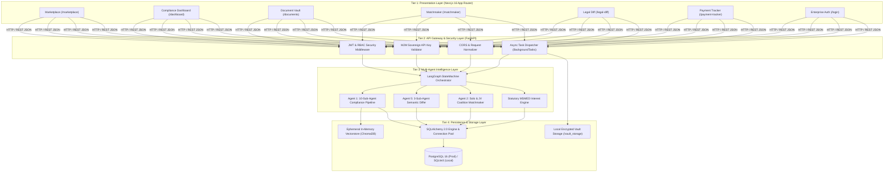
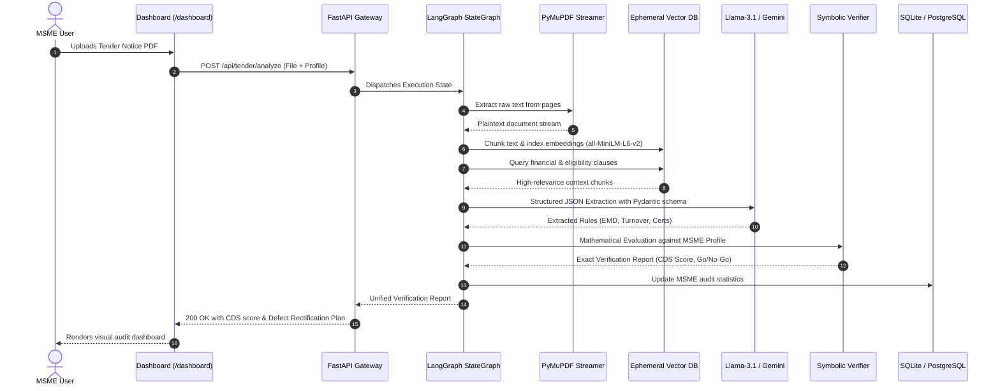
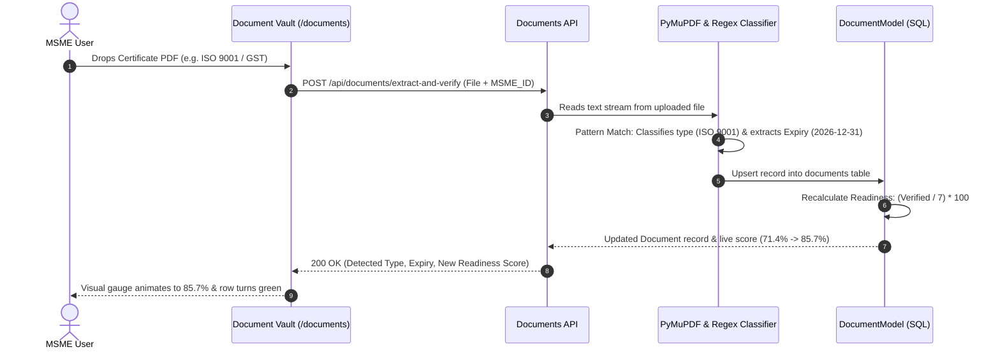
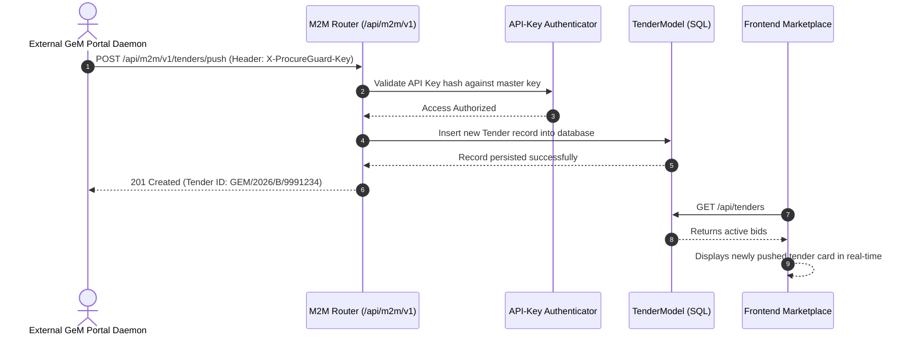

# ProcureGuard-AI: System Design & Architecture Document
**Scope:** Author's Individual Scope (Module 1, Module 2, Core Backend Framework, Persistence, and Frontend)  
**Academic Level:** Final Year B.Tech / M.Tech Capstone Project  
**Author:** Kamaladhi  
**Architecture Style:** Decoupled Micro-Tiered Architecture, Neurosymbolic AI, Multi-Agent Orchestration  

---

## 1. System Overview & Scope Definition

This document details the exact system design for the author's primary contributions to the **ProcureGuard-AI** platform. All descriptions strictly exclude peripheral teammate modules (Cartel GNN 2C, Financial Risk Agent 3, Cyber Bot 4, and Government Admin Portal).

### 1.1 In-Scope Subsystems
1. **Module 1 (Autonomous Bid Eligibility & Compliance Auditor):** 10-Sub-Agent pipeline extracting clauses, assessing technical/financial eligibility, computing CDS compliance scores, translating to vernacular languages, and generating actionable defect rectification roadmaps.
2. **Module 1 (Corrigendum Integrity & Tamper Detector - Agent 5):** Semantic redline difference engine tracking temporal modifications and clause dilutions between original tenders and corrigenda.
3. **Module 1 (Statutory Payment Recovery Engine):** Real-time automated calculator enforcing compounding interest penalties (3x RBI repo rate) under Sections 15 & 16 of the MSMED Act 2006, coupled with legal notice generation.
4. **Module 2 (Autonomous Matchmaker & Coalition Builder - Agent 2A & 2B):** Solo tender discovery engine and Joint Venture (JV) coalition builder that algorithmically pairs complementary MSMEs to overcome qualification barriers.
5. **Persistence & Data Pipelines:** Polyglot SQLAlchemy 2.0 ORM engine (PostgreSQL connection pool with SQLite fallback), auto-seeding engine, real-world MSME onboarding, and GeM PDF tender ingestion.
6. **Enterprise Infrastructure & Gateways:** 256-bit JWT authentication with Role-Based Access Control (RBAC), Machine-to-Machine (M2M) Sovereign API Gateway with `X-ProcureGuard-Key` headers, and non-blocking Asynchronous Background Job Queues.
7. **Frontend Application:** High-performance Next.js 16 (Turbopack) dark-mode user interface spanning all 8 core screens.

---

## 2. Multi-Tiered Architectural Hierarchy

ProcureGuard-AI operates on a **4-tier enterprise decoupled architecture**:

---

## 3. Subsystem Breakdown (Component by Component)

### 3.1 Presentation Layer (Frontend)
* **Framework:** Next.js 16.3.5 with React 19 and Turbopack compiler.
* **Styling Strategy:** Tailwind CSS 4 with custom dark HSL palette (`#0F172A` Slate-900 background, vibrant blue/indigo/emerald accents).
* **State & Routing:** Next.js App Router with Server-Side Rendering (SSR) fallback and dynamic client hydration (`'use client'`).
* **Resilience:** All dynamic search parameters (`useSearchParams()`) are wrapped inside React `<Suspense>` boundaries to guarantee zero client-side de-opt warnings during compilation.

### 3.2 Gateway & Authentication Layer
* **JWT Token Security:** Generates signed 256-bit HMAC-SHA256 tokens upon user verification.
* **Role-Based Access Control (RBAC):** Protects routes with decorators:
  * `require_roles(["msme"])`
  * `require_roles(["government_auditor", "admin"])`
* **M2M Sovereign Gateway:** Exposes programmatic endpoints (`/api/m2m/v1/*`) protected by `X-ProcureGuard-Key` headers for direct integration with external government servers (GeM / CPPP portal daemons).
* **Async Job Worker:** Heavy tender parsing tasks run via non-blocking worker threads, returning `202 Accepted` with a `job_id` and exposing `GET /api/jobs/{job_id}` for real-time progress polling.

### 3.3 Persistence Layer (Polyglot ORM)
* **ORM Engine:** SQLAlchemy 2.0 with connection pooling (`pool_size=10`, `max_overflow=20`, `pool_pre_ping=True`).
* **Polyglot Design:** 
  * If environment variable `DATABASE_URL` is set $\to$ Connects to PostgreSQL 16.
  * If `DATABASE_URL` is unset $\to$ Seamlessly falls back to local SQLite (`procureguard.db`).
* **Core Relational Schemas:**
  1. `msmes` (`MSMEModel`): Enterprise ID, statutory Udyam number, GSTIN, turnover, experience, capability tags.
  2. `tenders` (`TenderModel`): GeM bid ID, title, ministry, category, turnover threshold, EMD amount, deadline.
  3. `documents` (`DocumentModel`): MSME ID, classified document type, encrypted path, expiry date, audit status.
  4. `users` (`UserModel`): Email, bcrypt hash, role, linked enterprise ID.
  5. `async_jobs` (`JobModel`): Task status (`PENDING`, `PROCESSING`, `COMPLETED`), progress percentage, JSON results.
  6. `m2m_clients` (`M2MClientModel`): Client ID, API key hash, permissions.

---

## 4. End-to-End Request Dataflows

### Flow 1: Live Tender Analysis Pipeline (Module 1)

### Flow 2: Autonomous Document OCR & Readiness Gauge (Module 1 Vault)

### Flow 3: Machine-to-Machine Automated Ingestion (M2M Gateway)

---

## 5. System Design Principles Adhered To

1. **Separation of Concerns:** Presentation logic, business rules, multi-agent reasoning, and storage engines are completely decoupled.
2. **Deterministic Guardrails on Non-Deterministic AI:** The system never lets an LLM guess numerical eligibility. Generative AI extracts structured rules; the deterministic **Symbolic Verifier** calculates compliance mathematically.
3. **Graceful Degradation & Resilience:** If cloud LLM APIs experience rate limits, the system automatically falls back to regex-based heuristic extractors and offline embeddings without crashing.
4. **Zero-Configuration Portability:** The entire system functions out-of-the-box locally via SQLite, but can be scaled to multi-tenant cloud Kubernetes clusters via Docker Compose and PostgreSQL with zero code changes.
